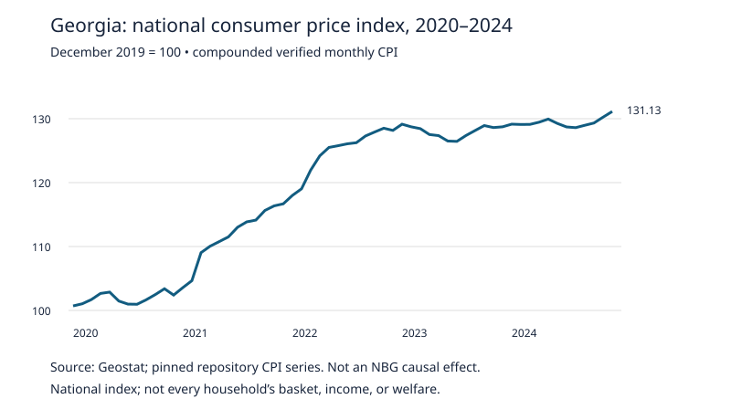

# Quantitative illustrations for public use

Generated values: [evidence_ledger.csv](evidence_ledger.csv). Reproduce offline with `python src/accountability_scenarios.py`. Source hashes and parent commit are locked. B means conditional arithmetic, **not measured policy harm**.

| Example | Inputs and calculation | Result | Required spoken qualification |
|---|---|---|---|
| National price pressure (C/B, N01–N04) | Compound all 60 monthly CPI relatives, Jan 2020–Dec 2024: factor 1.3113043. 1000×factor and 1000/factor | CPI-indexed spending: GEL 1,311.30; unchanged GEL 1,000: GEL 762.60 in Dec 2019 purchasing power | “National index, fixed nominal income illustration; not every family's basket or NBG-caused loss.” |
| Borrower repricing (B, S_RATE_*) | GEL 10,000 unchanged balance; +2 pp annual loan-rate shock; pass-through 0/50/100% | GEL 0/100/200 extra annual interest; full pass-through GEL 16.67 monthly equivalent | “Hypothetical, no principal repayment or fees; fixed-rate loans do not automatically reset.” |
| Currency debtor (B, S_FX_DEBT_*) | USD 100 monthly obligation; base 2.8068 GEL/USD; hypothetical GEL/USD +5/10/20% | Extra GEL 14.03/28.07/56.14 per month | “An increase in GEL per dollar means depreciation; this shock is assumed, not observed or attributed.” |
| Remittance recipient (B, S_FX_REMITTANCE_*) | USD 300 unchanged receipt; same base and shocks | Extra GEL 42.10/84.20/168.41 per month | “Extra nominal GEL receipts, not net welfare; imports and debt may also become dearer.” |
| Reserve financing sensitivity (B, S_CARRY_*) | USD 100m-equivalent matched position; effective annual financing-minus-return spread after currency matching/hedging −1/0/+1 pp | Net financing cost −USD 1m / 0 / +USD 1m | “Hypothetical carry, excludes crisis insurance; not actual NBG cost or budget loss.” |

The rate, FX and carry examples are separate scenarios, **not a combined household balance sheet**. Their assumed shocks are not calibrated causal responses to any NBG action. Sensitivity ranges vary named assumptions; they are not confidence intervals or statistical bounds on total welfare.

This national index figure is descriptive. The original [partial household figure](../../figures/pilot2017_partial_exposure.png) remains separate and unaltered. Do not splice its 2017 group baskets into the 2020–2024 chart: the pilot has not validated those later group exposures.

For a slide, use **one** illustration at a time. Preserve the base dates, currency units and qualification in the image caption and spoken explanation. Do not replace “index-linked illustrative spending” with “what every family now spends.”
