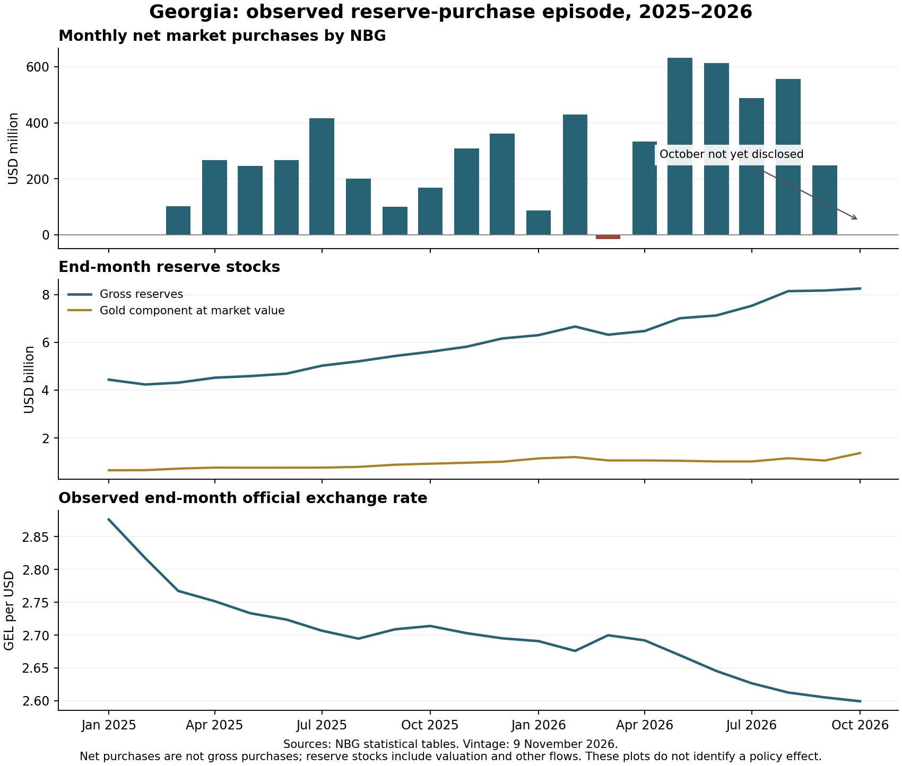

# Acquisition results — 9 November 2026

This release executes the existing reserve-purchase episode protocol. It contains measured observations and accounting decompositions; it does not estimate the exchange rate without purchases, an optimal reserve level, or net economic welfare.

## Verified numerical results

| Quantity | Result | Evidence and qualification |
|---|---:|---|
| 2025 net market FX purchases | USD 2,432.50 million | Sum of 12 monthly observations; matches NBG 2025 annual report p.47 and its 6 February 2026 release. Gross non-auction purchases and sales remain unknown. |
| January–September 2026 net purchases | USD 3,370.65 million | Nine reported months. March is net sales of USD 16.20 million; retained in the episode. |
| January–July 2026 net purchases | USD 2,566.58 million | Reconciles to USD 2,566.6 million in NBG's 7 September 2026 release within rounding. |
| 2025 reserve-stock increase | USD 1,710.724 million | End-2025 less end-2024 gross reserves. This is not the intervention total. |
| 2025 BOP reserve transactions | USD 1,207.767 million | Native annual BOP observation. Transactions minus market net purchases = −USD 1,224.733 million; the specific government/income/other components remain unresolved. |
| 2025 stock change less BOP transactions | USD 502.957 million | Valuation/other-volume/revision residual, **not** an identified pure FX or gold valuation series. |
| 2025 reserve interest income | GEL 401.870 million | Audited accrual, statement p.242; 2024 comparative GEL 439.181 million. Not a portfolio yield. |
| 2025 monetary-operation interest expense | GEL 129.331 million | Audited category; not the marginal cost of reserve accumulation. Monetary-operation interest income was GEL 673.078 million; IMF interest expense GEL 73.248 million is separate. |
| IMF 2025 reserve/ARA ratio | 94.8533% | Published April 2026 ARA dataset, metadata modified 18 May 2026. NBG's annual report says 104.8%. Definitions/adjustments/vintages have not been reconciled. Neither ratio is an estimated optimum. |

All calculations are in [intervention reconciliation](intervention_reconciliation.csv), [reserve bridge](annual_reserve_bridge.csv), [ARA component inputs](ara_component_inputs.csv), and [audited accounts](../../data/derived/episode_2026_11_09/annual_interest_accounts.csv). Original URLs, downloaded-file hashes and retrieval times are in the [source manifest](../../data/source_manifest.json). Workbook observations retain source sheet/row/cell coordinates. PDF statement values were checked visually and their number pairs are checked programmatically against the pinned PDF.

## Coverage actually obtained

- 81 monthly intervention observations, January 2020–September 2026; 56 dated auction records, March 2020–October 2024. Auction yearly sums match the monthly workbook for 2020–2024. No daily BMatch execution series was obtained.
- 2,505 calendar-valid official rate dates, January 2020–9 November 2026, for nine currencies; denomination conversions are recorded. Weekend valid rates are not independent weekend trades. Daily NEER has 2,504 dates; monthly NEER extends to October 2026 and REER to September.
- 82 monthly reserve stocks; 23 reserve-liquidity templates, December 2024–October 2026. Explicitly blank template cells are not treated as zeros or as proof that an exposure does not exist.
- 1,709 TIBR daily records; 357 refinancing events; 102 CD auction events; 345 **interbank** repo events. Daily money-market balances cover 31 December 2025–6 November 2026, not the full 2025 year. Central-bank survey: 81 months.
- BOP: 26 quarters and six separate annual totals; trade and transfer totals: 81 months; 249 country rows per transfer direction/month; travel: 27 quarters. Quarterly observations are never interpolated to months.
- Government external-debt stocks: 33 months, January 2024–September 2026, with four selected categories. September 2026 debt cash flows are available separately; they do not disclose government FX conversions. Debt includes accrued interest from 2026.
- SOFR, Cboe VIX and Federal Reserve broad-dollar observations, with distinct US information timing. Federal Reserve `ND` observations remain missing. Partner currency rates are descriptive inputs, not validated instruments or synthetic-control donors.

The [catalogue](../../data/derived/episode_2026_11_09/catalogue.json) records counts, coverage, units and missing cells for each output. Row counts include metadata and sparse cells and must not be described as independent economic observations. The [monthly panel](monthly_policy_panel.csv) contains 82 completed calendar months through October 2026. October intervention remains blank because the acquired disclosure stops in September. November daily observations are retained only in daily files.

## Validation qualifications

The [validation results](validation.json) distinguish passed checks from unresolved source comparisons. A qualified check is not a successful reconciliation.

1. The current 2023 monthly series sums to USD 1,279.25 million net purchases, versus USD 1,278.7 million in the preserved annual benchmark: USD 0.55 million unresolved. The non-auction component differs by USD 0.50 million; auction rounding accounts for the remaining USD 0.05 million. No archive value was overwritten.
2. Auction trade-date monthly totals differ across September/October 2021 and August/September 2022. The differences match the USD 60 million and USD 32.305 million month-end events. Next-business-day settlement is a plausible explanation, not a verified reassignment of dates. Annual sums reconcile.
3. February 2026 reported bank USD sales total is USD 522.661704 million below its reported components. Retain the original and exclude that total from validated turnover applications. Small earlier residuals are also listed.
4. The money-market government-security total on 30 July 2026 is GEL 10,031.823538 million below its components. Quarantine that total; bank-deposit and refinancing component identities pass.
5. The by-month transfer workbook omits 2024. The by-country workbook supplies it and reconciles to country sums. Overlapping files differ by at most USD 0.002 million; both vintages remain auditable.
6. Daily NEER omits 11 October 2025. No forward fill was performed. MoF labels June 2025 `31.06.2025`: retain the source label and month, leave the exact date missing.
7. National M2, M3, original-maturity short-term debt and IIP liabilities have been extracted. Residual-maturity debt and IMF adjustments have not been verified. The independent ARA field remains empty; published ratios are never backsolved into invented components.

## Completed requirements and remaining work

See the [requirement status](../../research/ACQUISITION_STATUS.md). Public monthly accounting and the common 2025–September 2026 descriptive window are now usable with the stated exclusions. Protocol gates G1–G5 are **not collectively passed**: the full transaction/valuation bridge, purchase assignment and counterfactual, incremental funding attribution, usable-reserve stress calibration, and joint welfare comparison remain incomplete.

No formal request was sent. No claim of deliberate non-disclosure is made. The next binding data request is nonidentifying daily gross BMatch purchases/sales with execution and settlement times, operational rule versions, and government FX conversions. Public-source investigation remains necessary for historical government cash-flow releases, 2025 daily liquidity, residual-maturity debt vintages, and external security prices.

