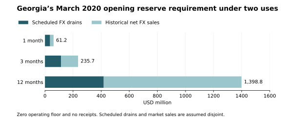

# How much opening foreign currency would have covered Georgia’s historical cash calls?

**Step 3, 22 November 2026.** At 31 March 2020 the reported schedule of public FX loans, securities and deposits implied **$418.31m** in net drains over the next twelve months. Replaying the market sales Georgia subsequently chose adds **$980.47m**. With no new receipts, a zero operating floor and disjoint uses, the two accounts required **$1,398.78m** of opening resources convertible into the settlement currencies. Market sales account for **70.1%** of that combined amount. The historic sales budget is a policy choice; a floating-rate government could choose a different budget. The result prices a specified set of uses and leaves Georgia’s economy-wide optimum open.

## What binds in the pandemic window

| From 31 March 2020, USD million | 1 month | 3 months | 12 months |
|---|---:|---:|---:|
| Section II.1 scheduled net FX drains | 36.44 | 114.77 | 418.31 |
| Historical market sales, net | 24.80 | 120.95 | 980.47 |
| Opening balance to cover both | **61.24** | **235.72** | **1,398.78** |
| Both, preserving the Step 2 fixed $34.01m operating floor | 95.24 | 269.73 | 1,432.79 |

The last horizon ends **31 March 2021**. The opening NBG template gives cumulative maturity buckets; we difference them to obtain incremental uses. Monthly sales from April 2020 through March 2021 follow NBG's all-market net figures, including $164.4m in January–March 2021. Receipt access is set to zero for this schedule, and no contingent liability is assumed called. The combination assumes NBG settles the scheduled public uses, that the sales reach different counterpart obligations, and that the USD equivalents can be delivered in the required currencies at the reported values. Missing encumbrance and currency data preclude an unconditional liquidity claim. A change in gross reserves is never used as an intervention flow. [Source schedules](../reserve_buffer_policy/scheduled_calls.csv) · [Historical sales](../historical_fx_shocks/cases/monthly.csv) · [2021 extension](../../data/derived/r3_fx_response/monthly.csv)



**A smaller opening balance fails before year-end.** With half of the twelve-month combined requirement ($699.39m) and net sales at month-end, the first uncovered payment group is September sales if public dues fall at the start of each maturity bucket, or October sales if they fall at its end. Timing changes the first failed payment. Because all three bucket increments and these monthly net sales consume cash, it leaves the twelve-month total unchanged. A reported month-end below zero measures the funding shortfall in a full-payment ledger. It does not predict default, and an endpoint for a maturity bucket does not establish an execution day. [Forward paths at the minimum and at half that amount](forward_paths.csv)

**What securities would have to deliver.** The March opening comprised $650.61m of FX cash and deposits and $2,552.44m in FX securities. If all those deposits are accessible and currency-matched, deposits alone cover the three-month combined stress. In the twelve-month combined stress they leave **$748.17m** of proceeds to raise. At the Step 2 discount of 5%, that requires securities with an opening market value of **$787.55m**, or **30.9%** of reported FX securities. Their contractual par values are unknown. The calculation applies a percentage discount to the carrying market value. SDRs, gold and other assets supply no proceeds in this narrow case. The floor raises required proceeds to $782.18m.

For the two-business-day mobilization sensitivity, assume the free securities can be sold at opening, that proceeds arrive before the documented 27 April $20m auction, and that no other restrictions apply. If all April claims fall after settlement, the securities alone cover the combined test at zero floor. If the full first public bucket ($36.44m) and remaining April net sales ($4.80m) fall before settlement, **$41.24m in immediately available cash** is needed. These endpoints use one-direction residual sales. Unknown gross purchases or reversals could change intramonth needs. Neither endpoint estimates Georgian trading haircuts, settlement delays, or actual sales of reserve securities. [Asset mobilization and costs of the floor](security_mobilization.csv)

## What changes if official financing pays Treasury bills?

The second reconstruction uses **realized debtor totals** for 2020Q2 in place of the opening maturity schedule. MoF reports government service of $103.6m, including the independently documented bond coupon, and NBG service of $0.8m. Their $104.4m sum differs by $0.1m from the separately rounded principal-plus-interest breakdown. The Treasury starts with zero external cash, pays from its own external account when possible, and receives an immediate NBG backstop for uncovered bills. Later Treasury receipts cannot retrospectively cover earlier bills or finance NBG market sales. We assume NBG must pay its own $0.8m. This is a specified settlement arrangement, not a finding about the actual account used.

| Permitted Treasury receipts | Other service late, USDm | Other service early, USDm | Including Q2 sales, late / early, USDm |
|---|---:|---:|---:|
| May IMF and original World Bank drawings accessible | **17.99** | **104.40** | **138.94 / 225.35** |
| Pre-existing World Bank facility alone accessible | **55.60** | **104.40** | **176.55 / 225.35** |
| No usable receipts | **104.40** | **104.40** | **225.35 / 225.35** |

The $17.1875m coupon is kept inside government service, on its nominal April date; actual value day is unknown. Assume it clears before May funding. For the rest, place government and NBG service together at either end of the quarter. If the other bills arrive late, full access to the May receipts leaves only the coupon and NBG's own service for opening reserves to cover. If the bills arrive early, the later receipts leave the entire $104.4m opening need intact. The IMF drawing of SDR 147m is valued at $200.34m on 5 May. The EUR 45m World Bank facility is valued at $48.80m on 6 May using 3.4702 GEL/EUR divided by 3.1998 GEL/USD. Both conversions assume no spread, immediate access in the right currency, gross face available and permission to pay debt service. The largest-to-smallest conditional gap is $86.41m. The actual Treasury funding requirement could lie outside these selected scenarios if omitted resources or liabilities are material.

Keep the currencies separate when conversion is unavailable. For the coupon and scheduled IMF charges alone, zero external offsets require **USD 17.1875m and SDR 0.592870m** through three months. Through one month the SDR leg is 0.002248m. Credit in EUR cannot discharge either leg by itself. If Treasury pays the coupon from a pre-existing deposit at NBG, gross NBG delivery still occurs. If it pays out of a funded external Treasury account, the coupon creates no NBG delivery. The settlement evidence cannot choose between these treatments. [Dated and projected payments](../historical_fx_shocks/payment_calendar/payments.csv) · [Financing cases](../reserve_buffer_policy/funding_cases.csv) · [Official currency quotes](../../data/derived/episode_2026_11_09/official_fx_daily.csv) · [Treasury cash and backstop by event](treasury_cash.csv) · [Source and accounting crosswalk](../historical_fx_shocks/payment_calendar/README.md)

## Earlier shocks

**2009 IMF principal.** The 2009 annual transaction file records SDR 17.96m principal paid and SDR 220.8m drawn. In the member account, assume each drawing can be used for subsequent SDR principal from its recorded date. The opening SDR requirement is **3.15m at one month, 7.38m at three months and 7.38m at twelve months**. The three- and twelve-month peaks occur on 20 March, before the 25 March drawing. Retaining only the pre-approved SDR 63.1m tranche, drawn on the same date, gives the same peak. Removing all drawings raises the annual requirement to **SDR 17.96m**. Holding SDR 3.69m (half of 7.38m) would first leave principal uncovered on **5 February**. Funding availability and ultimate domestic payer are conditions of this member-account calculation. The restricted USD-valued principal paid before the March drawing was $11.03m. [Complete annual principal extract](imf_2009_full_year.csv) · [IMF original source and hash](../historical_fx_shocks/cases/imf_sources.json)

**2009 market operations.** Preserve the seven March auctions on their recorded dates, including a $5m purchase. Net auction sales were $14m. Against reported all-market net sales of about $142m, $128m remains without a date. Treat that residual as a single one-direction budget. With IMF charges included at scheduled values, IMF principal at actual values, and the March drawing usable and converted into USD on arrival, the Q1 combined peak is **$22.32m if residual sales fall last, or $150.32m if they fall first**. With only the pre-approved tranche drawn, the late-sales peak rises to **$59.32m**. These endpoints respect the known auctions and assume access to pooled USD for both obligations. The unobserved gross flow pattern can exceed this net-budget stress. The Q1 fiscal reporting account separately has GEL 26m in payments and GEL 37m in borrowing. Its timing cases give GEL 0–26m. Settlement currencies cannot be recovered from those totals. [Auction tape](../../data/derived/r3_fx_response/auctions.csv) · [Fiscal and payment records](../historical_fx_shocks/payment_calendar/README.md)

**Private-bank support.** Bank of Georgia’s named $65m January loan repayment and $49m June put redemption imply an incremental NBG requirement of zero if the bank pays both itself. If the bank has no usable matching resources or replacement funding, meets the eligibility test and posts sufficient collateral, full support for these two principal amounts requires USD 65m at one and three months, and USD 114m over the year. This twelve-month figure covers only those two named debts. It does not measure system withdrawals, the bank's total annual obligations or actual assistance. Under a simultaneous public-plus-bank scenario without conversion, preserve the distinct opening accounts: at three months, SDR 7.38m for IMF principal plus between USD 0 and USD 65m for the named bank payment under these extremes. Unknown bank-level eligibility and matching assets prevent choosing a point within that interval.

**August 2008.** The one-month zero-receipt replay of the documented market-sales budget requires about **$187m**. The IMF financing and sovereign wealth fund transfer arrived in September. Their timing rules them out as funding for August sales. Unquantified public imports, branch banknote shortages, and incomplete all-venue sales beyond August preclude a comparable broad three- or twelve-month minimum. Empty coverage stays missing. [2008 chronology](../historical_fx_shocks/war_chronology.csv) · [Coverage by account and horizon](coverage.csv)

## Method and reproducibility

For an opening immediately usable balance, let each event have signed use equal to eligible payments minus accessible receipts. The minimum is the maximum, over the opening and every event through the horizon, of the required floor plus cumulative signed use. Floor zero measures payment coverage. The separate USD floor equals 1% of observed opening gross reserves and is held fixed even when testing smaller openings. Native SDR and fiscal GEL accounts report zero-floor results only. Equal-date events settle jointly in the daily scenarios. With no documented payment priority, any tied claims bind as a group. The forward check starts at the calculated minimum, posts every debit and credit and verifies that the lowest balance equals the floor. A second path starts at half the minimum and distinguishes the first floor breach from the first unpaid cash amount. Quarter or maturity bucket endpoints in the output are timing conventions. Incomplete horizons have no result for the missing account. Blank amounts of accessible funding remain unknown outside an explicit scenario.

[All minima, binding events and shortfalls](minimums.csv) · [Scenario event ledger](scenario_events.csv) · [Step 2 policy rules](../reserve_buffer_policy/README.md)

Run from the repository root:

```sh
python src/minimum_reserve_buffer.py --check
python src/minimum_reserve_buffer.py --from-raw --check
python -m unittest discover -s tests -p test_minimum_reserve_buffer.py
python replication/plot_minimum_buffer.py
```

The first command rebuilds all numeric outputs offline from tracked extracts. The second additionally verifies the full 2009 IMF extract against the cached, SHA-256-locked original and reconciles its annual column totals. Frozen upstream outputs can be rebuilt via the Step 1 and Step 2 instructions. The figure uses Matplotlib. Tests check the formula against an exhaustive small-grid cash simulation, receipts arriving early or late, duplicate claims, jointly binding payments, calendar horizons, fixed floors, bank ownership, Treasury ring-fencing and source reconciliations.

**Decision for Step 4.** The method now supports historical accounting within named obligations, financing rules and currencies. The next test is predictive: freeze the historical information set, competing benchmark, and scoring rule before inspecting holdout errors. An evaluation with only revised data can be described as a retrospective stress replay. The historical thresholds above establish neither an optimal Georgian reserve stock nor that 2025–26 purchases were necessary or excessive.
