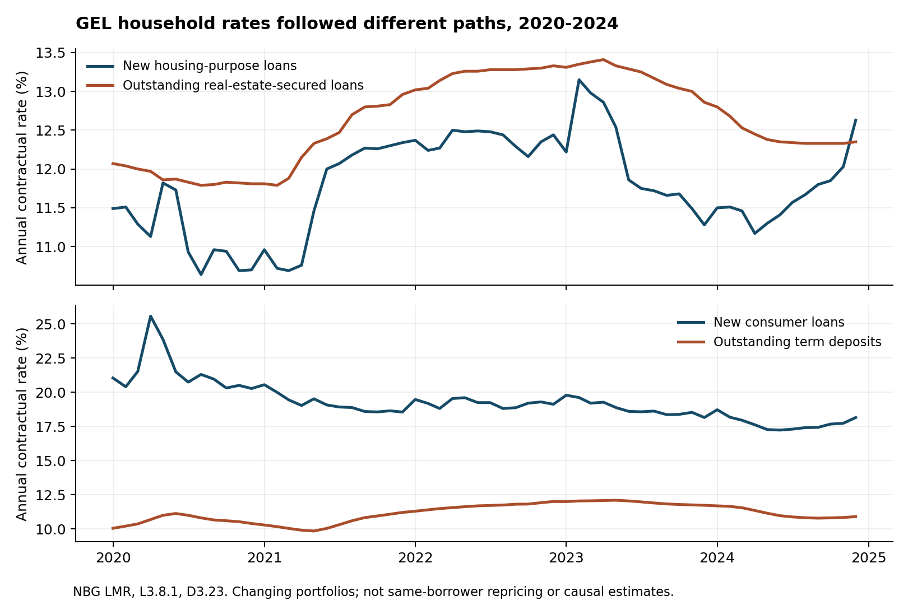
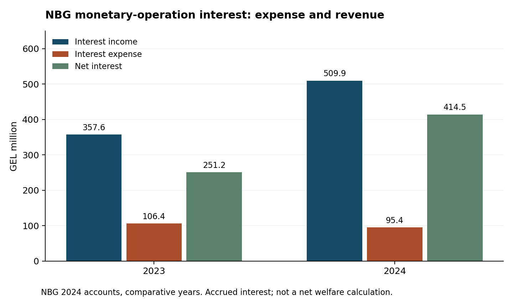

# Monetary Sovereignty, Financial Costs and Household Exposure in Georgia

## An accounting and counterfactual audit of National Bank policy

**Nikoloz Oniani**

**Working paper v0.2 · 8 November 2026 · Prepared for external review**

Public research question: **„რატომ და როგორ გვაღარიბებს ეროვნული ბანკი?“** The question motivates investigation; it is not the paper's assumed conclusion.

## Abstract

This paper investigates how monetary policy distributes financing costs, liquidity and financial insurance in Georgia. It combines a verified 2020–2024 policy panel, 46 monthly household credit and deposit series, an existing partial household price-exposure pilot, and newly extracted National Bank of Georgia (NBG) financial accounts. Three contributions follow. First, retail prices moved differently: new GEL housing-loan rates rose while new consumer-loan rates fell between December 2020 and December 2022. A synthetic indexed-loan experiment measures conditional payment exposure, without attributing a net welfare loss. Second, NBG's 2024 monetary-operation interest expense was GEL 95.361 million, against GEL 509.859 million of corresponding interest income. Currency in circulation increased by GEL 682.880 million while currency plus GEL monetary-policy liabilities to financial institutions declined by GEL 380.386 million. These results reject gross-cost and banknote-issuance shortcuts to measuring public loss or money creation. Third, an independent algebraic and numerical audit of Cangul and Abel's 2026 reserve model identifies a sign inconsistency in the published dollarization presentation and quantifies that channel in isolation. Its stated calibration implies only 0.00435% of GDP in expected crisis-loss reduction for a ten-percentage-point reserve/GDP increase at a 10% crisis probability. This is not the total insurance benefit or a replication of the reported optimum. Our evidence supports differentiated distributional accounting and stronger model reproducibility. It does not identify the sign of NBG's aggregate welfare effect.

Keywords: monetary sovereignty; household finance; international reserves; dollarization; central-bank accounting; Georgia. JEL: E52, E58, F31, G51.

## 1. Question, contribution and competing propositions

Monetary sovereignty gives a central bank the capacity to issue domestic settlement money, set the terms of liquidity and influence domestic financing conditions. It does not give unlimited command over foreign purchasing power. Georgia's foreign-currency exposures make the distinction material: more GEL liquidity cannot by itself create the foreign exchange needed to service a dollar obligation. Yet reserve insurance also has costs and a distribution. Evaluating policy requires both sides of that balance sheet.

The paper asks three connected questions. Which household financing and purchasing-power pressures are observed? What costs, revenues and balance-sheet movements can be attributed to NBG's operations as accounting facts? And how robust is the quantitative case for additional reserves once the assumptions connecting reserves to welfare are exposed?

The contribution is a reproducible country-specific integration of observations, accounting and explicitly conditional calculations. It does not claim a globally unprecedented model. The new empirical work is the cell-traceable household credit panel, the annual-account extraction and reconciliation, and the numerical audit of the reserve model. The existing household pilot and policy panel are retained. Our inferential discipline is consequential: nominal interest expense is not national welfare loss; a central-bank accounting profit is not proof of welfare gain; a simulation's optimum is conditional on its objective and calibration.

We consider competing propositions rather than selecting evidence for a verdict. Tightening can increase an indexed borrower's payment while protecting real income against persistent inflation. Reserve purchases can incur financing costs while reducing crisis risk. Commercial-bank payments from the central bank can compensate compulsory balances rather than constitute a subsidy. Public reserves can substitute for private insurance, but the strength, timing and distribution of that substitution require evidence. Each proposition leaves room for a zero, beneficial or adverse net effect.

## 2. Data and measurement

The primary historical window is January 2020–December 2024. The literature audit extends through Cangul and Abel (2026); its contemporary reserve-coverage numbers are not assigned to 2024 or to November 2026. All monetary values retain their original units before conversion.

| Evidence block | Verified content | Principal limitation |
|---|---|---|
| Monthly policy panel | 60 months of policy rates, reserves, official GEL/USD, CPI and interbank rates; dated decisions separately | Current download vintage; no causal policy shock identified |
| Credit and deposits | 46 series × 60 months; seven official workbooks; 2,760 cell-traceable values | Changing portfolios, residents/nonresidents and individual entrepreneurs in several tables |
| NBG financial accounts | 64 source observations for 2023 and 2024; income, expenses, balance-sheet and currency rows | Annual accrued accounting; not instrument-level cash settlements |
| FX annual benchmarks | Auctions and BMatch, separately, for 2023 and 2024 | Net annual flows do not supply missing execution dates |
| Household pilot | 2017 survey and limited expenditure-to-CPI matches | Incomplete basket coverage and no linkage to loan contracts |
| Reserve-model audit | Published equations and calibration in Cangul and Abel (2026), Annex I | Implementation code and complete model replication not available in this packet |

The credit series pass 360 internal identities across purpose, residency and sector tables. The annual-account extraction passes twelve identities, including assets against liabilities plus equity, interest income against expense and net interest, and currency issuance against withdrawals. These checks validate extraction consistency; tables built from the same bank reporting system are not statistically independent measurements. Source hashes, URLs, PDF pages, source rows, cell coordinates and input locks accompany the data.

Annual financial-statement observations come from the NBG's 2024 Annual Report, including its 2023 comparative column. Values reported in thousands of GEL are divided by 1,000 to obtain GEL million. PDF page numbers are distinguished from printed pages. The accounts were authorized on 17 April 2025; year-end positions are not annual averages. Missing transaction and valuation components remain missing. In particular, an interest rate multiplied by a year-end balance is not used to manufacture annual expense.

We distinguish documented observations (A), arithmetic identities (B), descriptive or conditional estimates (C), model-dependent policy counterfactuals (D), and untested hypotheses (E). The credit claim ledger uses these distinctions explicitly. Statistical confidence intervals are not attached to deterministic accounting. Relevant uncertainties are source revisions, composition, unmatched expenditure, missing contract terms and behavioral/model assumptions.

## 3. Household purchasing power and contractual exposure

### 3.1 Prices and the limits of the household bridge

The preserved monthly CPI observations compound to a 31.13% rise from December 2019 to December 2024. An unchanged, unremunerated GEL balance consequently retains about 76.26% of its initial CPI-deflated value. This reciprocal calculation is not the experience of a household whose income, consumption or interest receipts changed. It cannot assign inflation to NBG rather than external prices, fiscal demand, supply disruptions or expectations. [Existing accountability ledger N01–N04; Geostat source in the policy manifest.]

The household pilot's expanded mappings cover a weighted mean 40.92% of expenditure, leaving 59.08% unmatched. Its partial contributions cannot rank total inflation across income groups. A pension-age-member group is not identical to pension recipients. Repeated household-quarter identifiers are not a longitudinal panel spanning independently sampled annual surveys. We retain these limitations rather than attach the new loan results to incompatible survey groups. [Pilot2017_Methods_and_Results; pilot2017_validation.json.]

### 3.2 Observed financing prices

| Annual contractual rate (%) | Dec 2020 | Dec 2022 | Dec 2024 |
|---|---:|---:|---:|
| New GEL housing-purpose loans | 10.70 | 12.44 | 12.63 |
| New GEL consumer loans | 20.28 | 19.13 | 18.16 |
| Outstanding GEL real-estate-secured household loans | 11.81 | 13.33 | 12.35 |
| Outstanding GEL household term deposits | 10.41 | 12.02 | 10.91 |

Sources: NBG LMR, L3.8.1 and D3.23; credit supplement Table 1 and cell ledger. Rates are nominal contractual averages, not fee-inclusive APRs or within-borrower changes. Real-estate collateral is not the same as housing purpose. Zero-rate contracts are excluded from published rate weights, so multiplying an unmatched total stock by the average rate would be invalid.

The pattern contradicts a uniform increase in household borrowing prices. It also shows a potential offset for savers, although nominal deposit returns do not establish positive real returns. Risk, borrower selection, maturity, competition and contract composition can change these averages. No causal pass-through coefficient is estimated.

### 3.3 Contract accounting

For principal P, monthly rate r and remaining months n, the level payment is `A = P*r/[1-(1+r)^(-n)]`, with `A=P/n` at zero interest. At the observed new-housing rates, an assumed GEL 100,000, twenty-year loan has payments of GEL 1,011.85 in December 2020 and GEL 1,131.91 in December 2022: a standardized difference of GEL 120.06 per month. Size and maturity are assumptions, not estimated representative values.

A separate synthetic contract starts in January 2021 with GEL 100,000 outstanding and twenty years remaining. It resets monthly to the policy rate effective at the month's start plus an assumed three-percentage-point margin. Relative to holding the policy reference at 8%, additional payments over 2021–2024 are GEL 5,933.06. Additional interest is GEL 7,112.35 and terminal principal is GEL 1,179.29 higher. Thus additional payments equal additional interest minus additional terminal debt. This avoids mistaking accelerated principal repayment for cost or ignoring deferred principal.

The full supplement varies maturity, reset frequency, every reset phase and benchmark linkage, with 132 cases. An alternative held 9% reference reduces the main payment difference to GEL 2,625.97. Neither reference is an identified feasible macroeconomic alternative. No claim is made about nationwide incidence, consumption loss or poverty. Fees, caps, floors, payment holidays, refinancing and defaults remain outside this contract experiment. Actual distributional measurement requires linked balances, reset dates, income and deposits.

## 4. Monetary operations: expenses, revenues and the banking relationship

### 4.1 What the financial accounts establish

| GEL million, annual accrued interest | 2023 | 2024 |
|---|---:|---:|
| Reserve interest income | 479.640 | 439.181 |
| Monetary-operation interest income | 357.605 | 509.859 |
| Monetary-operation interest expense | 106.380 | 95.361 |
| Net monetary-operation interest | 251.225 | 414.498 |
| Total net interest income, all reported categories | 635.347 | 755.933 |

Source: NBG 2024 Annual Report, printed p.273/PDF p.274; `annual_accounts.csv` and `annual_results.csv`. Positive expense figures here denote outlays; the raw ledger preserves their negative accounting signs. Total net interest includes additional income and expense categories and is not total accounting profit.

In 2024, monetary-operation expense comprised GEL 5.124 million on issued debt securities and GEL 90.237 million on amounts due to resident financial institutions. Income comprised GEL 334.180 million from resident financial institutions and GEL 175.679 million from securities. The central bank received GEL 243.943 million more interest from resident financial institutions than it paid on the corresponding liability category. This is an accounting comparison, not a complete bilateral transfer ledger or a measure of bank welfare.

These findings contradict a description of the disclosed monetary-operation expense as an unoffset central-bank loss. They also narrow the transparency criticism: aggregate expenses are publicly reported. Earlier repository reports left their retrieval unresolved; this paper supplies the observations and supersedes that specific access gap. Instrument-level attribution remains unresolved. Required reserves, correspondent balances and overnight deposits have different functions and currency terms. The entire GEL 95.361 million cannot be labeled the sterilization cost of FX purchases.

The financial notes show GEL obligatory reserves remunerated at 8% at end-2024, and USD/EUR obligatory reserves at 4%/2.5%; these are endpoint rates, not full-year realized returns. Published debt securities were certificates of deposit with GEL 60 million nominal outstanding at both year ends. [Notes 19 and 23, printed pp.302–303.] An annual expense attributed to a particular FX purchase requires daily instrument balances, remuneration schedules, settlement dates and an explicit marginal funding counterfactual. Neither the policy rate nor TIBR substitutes for that ledger.

The strongest criticism that survives is about distribution and justification, not an assumed subsidy. A subsidy calculation would compare actual compensation with a defensible risk- and liquidity-adjusted alternative, including the regulatory burden of compulsory reserves. A large gross payment is insufficient. Conversely, positive central-bank net interest does not prove optimal policy: revenue can coexist with costly credit rationing or unequal incidence. Government securities held by NBG and transfers to government must be consolidated before interpreting national resource costs.

### 4.2 Creation, replacement and the composition of money

During 2024, NBG issued GEL 11,658.142 million in banknotes and GEL 103.831 million in coins, but withdrew GEL 10,997.498 million and GEL 81.595 million respectively. Net currency growth was GEL 682.880 million. Gross printing therefore exaggerates the change in currency outstanding by including replacement and circulation turnover. [Note 22, printed p.303; tested currency identity.]

Even net currency growth is not the whole liquidity story. GEL correspondent balances of financial institutions fell from GEL 1,591.879 million to GEL 486.952 million; overnight deposits rose from GEL 167.006 million to GEL 208.667 million. Currency plus these two GEL liability categories fell from GEL 7,693.023 million to GEL 7,312.637 million, a decline of GEL 380.386 million. This explicitly defined accounting sum is not asserted to equal a published monetary aggregate. It demonstrates that increasing banknotes and declining other settlement-liquidity balances can coexist.

At the same time, GEL claims on financial institutions rose from GEL 3,738.771 million to GEL 7,003.577 million. That asset expansion is not automatically a grant: a central-bank loan creates a claim with repayment terms, matched by liability and other balance-sheet changes. Commercial banks also create deposits through lending, subject to credit demand, capital, liquidity and regulation. The present dataset does not estimate a money multiplier or a causal inflation response to balance-sheet growth. Claims that each newly issued GEL mechanically produces a fixed amount of inflation are not supported.

## 5. FX intervention, reserve ownership and stock-flow reconciliation

Let reserve-stock change equal net executed FX purchases plus government-related transactions, investment income, valuation and other movements. The identity does not identify its components when transaction records are missing. Using annual net-intervention benchmarks gives:

| USD million | 2023 | 2024 |
|---|---:|---:|
| Change in official reserve stock | +108.074 | −561.050 |
| Net auction plus BMatch purchases | +1,278.700 | −434.750 |
| Remaining composite | −1,170.626 | −126.300 |

Sources: existing NBG monthly reserve panel and annual benchmarks; `reserve_bridges.csv`. Purchases are positive here, reversing the sales-positive convention in the original benchmark CSV. The 2023 intervention total combines auction sales of USD 166.8 million with BMatch purchases of USD 1,445.5 million. The 2024 total combines net sales of USD 382.1 million and USD 52.65 million respectively. Settlement timing and definition differences preclude forcing annual results into missing monthly execution dates.

The particularly large 2023 composite is a concrete reason that reserve growth is a poor intervention proxy. It is not an unexplained financial loss: it jointly contains transactions and valuation not separately recovered here. A monthly reserve bridge should identify government debt service and external receipts, returns, security-price effects, gold effects and currency translation. The financial statements' GEL foreign-currency revaluation amounts cannot be inserted mechanically into a USD reserve-stock reconciliation with a different asset scope.

Gross reserves also are not unencumbered fiscal wealth. NBG's reported FX financial assets minus all reported FX liabilities declined from GEL 6,020.217 million in 2023 to GEL 3,348.369 million in 2024. Obligatory FX reserves of commercial banks rose from GEL 4,312.166 million to GEL 6,369.707 million. This is a net accounting position, not a measure of immediately usable international liquidity: maturities, access restrictions, settlement currencies and accounting/statistical perimeter differences matter. A gross adequacy ratio should therefore be accompanied by liquidity and liability disclosures, not replaced uncritically by this net figure.

FX purchases initially supply GEL to the seller; sales absorb it. Subsequent operations can offset that liquidity effect. A stylized marginal financing cost is the remuneration on the incremental liability less the return on the corresponding reserve asset, with exchange-rate exposure, maturity and valuation treated separately. The financing liability may instead be unremunerated currency, an obligatory reserve balance or government funds. Assuming every reserve dollar is financed at the GEL policy rate is unjustified. No national carry-cost total is fabricated here.

## 6. Independent evaluation of reserve-adequacy targets

### 6.1 What must be distinguished

Cangul and Abel (2026), completed in May and released in June, extend a sudden-stop insurance framework with sovereign-spread, dollarization and FX-intervention channels. They report approximately 130% of ARA in the baseline and 145–150% in the extended model at a 10% crisis probability. These are conditional model outputs, not legal requirements or empirical welfare optima identified by an experiment. Their abstract describes coverage around 105%; the conclusion uses 102%. We preserve both reference values rather than silently selecting one. [CA2026, abstract, paragraph 13 and Annex I.]

Holding the ARA denominator fixed, moving from 105% to 145–150% requires 38.10–42.86% more reserves; from 102%, it requires 42.16–47.06%. These are ratio conversions, not estimates of a current financing requirement. The economic decision must compare marginal benefits and marginal financing costs, account for changes in the ARA denominator, and identify how reserves would actually be accumulated.

The 2025 IMF intervention study is distinct. Its QIPF counterfactual supports short-run stabilization benefits within its model, while acknowledging fundamental-news versus sentiment ambiguity and longer-run costs. This is material counterevidence to a blanket anti-intervention conclusion. It does not independently establish the 2026 reserve target, nor does it identify household incidence. The primary panel's endogenous policy actions and contemporaneous CPI cannot resolve that causal question by simple regression.

### 6.2 Algebraic audit

Annex I specifies declining dollarization `D(R)=0.6−0.10*ln(1+R)`, with GDP normalized to one, and crisis loss `L(D)=0.10*(1+0.5*D)`. Therefore `L_D>0`, `D_R<0` and `dL/dR=−0.005/(1+R)<0`. The derivative of the loss term in an expected-welfare expression `−π*L(D(R))` is positive: additional reserves reduce that modeled loss.

On printed page 12, however, the displayed marginal-cost side subtracts `π/(1−π)*L_D*D_R`. Subtracting this negative product raises the displayed cost, although the accompanying interpretation describes a reduction. If a separate direct-insurance marginal benefit is held on the left, putting the dollarization benefit into net marginal cost requires adding the negative derivative product, not subtracting it. The equation also introduces an average-loss-over-reserves term whose derivation from the earlier objective is not supplied. These are reproducibility and sign inconsistencies in the published presentation. The PDF page was checked visually, so this finding does not rest on OCR alone.

This audit does not prove the authors implemented the wrong sign. The code could use a positive benefit variable consistently, while the paper's notation is wrong. We have not reconstructed their entire optimum and do not report a corrected ARA target. A decisive replication needs the objective actually optimized, parameter units, baseline cost parameters, normalization to ARA, numerical domain and constraints, and the code producing each extension. The proper response is to resolve those ambiguities before treating the target's precision as established.

There is a second mathematical clarification. A spread schedule `s(R)=s0−k*ln(1+R/Y)` is decreasing and **convex**, because its second derivative is positive. The annex first describes a concave function and later invokes convexity. The displayed functional form has diminishing spread reductions and is economically interpretable; the inconsistent adjective does not itself invalidate its calculations. Its stated 50-basis-point reduction for reserves/GDP rising from 0.10 to 0.20 is approximately reproduced by `k=0.0575` in decimal rate units, or 5.75 when rates are percentage points. Treating 5.75 as a decimal would produce a hundredfold unit error. Our code tests the consistent conversion rather than alleging that error occurred in the IMF implementation.

### 6.3 Original numerical audit of the isolated channel

Under the annex's stated dollarization calibration, increasing reserves from 10% to 20% of GDP reduces modeled dollarization by **0.8701 percentage points**. Conditional crisis consumption loss declines by **0.04351% of GDP**. At an assumed 10% crisis probability, the expected loss reduction is **0.004351% of GDP**. These values follow directly from the logarithmic functional form; they are not Georgian causal estimates of reserve effectiveness.

| Assumed annual carry in normal states | Probability-weighted cost of the extra reserves (% GDP) | Isolated expected loss reduction / cost |
|---|---:|---:|
| 1% | 0.090 | 4.83% |
| 2% | 0.180 | 2.42% |
| 4% | 0.360 | 1.21% |

Calculation: expected loss benefit is `π*[L(0.10)−L(0.20)]`; normal-state cost is `(1−π)*c*(0.20−0.10)`, with π=0.10. All cost rates are assumptions. The sensitivity CSV additionally varies the reserve interval and crisis probability. The comparison uses expected loss units, not a full CRRA utility calculation or a multiperiod net present value.

This is a channel audit, not a finding that reserves fail a full benefit-cost test. Direct consumption smoothing, sovereign spreads, crisis probability changes, FX liquidity and other insurance benefits are omitted. The result establishes how much of a broader case would have to come from those other channels under the stated calibration. It also shows why a modest modeled change in private dollarization should not be presented as independently sufficient justification for an expensive reserve expansion.

### 6.4 Competing explanations and falsifiable extensions

The dollarization response is imposed in this functional form. Credibility, relative returns, prudential rules, remittances and exchange-rate valuation can jointly affect reserves and private FX holdings. The credit data show substantial FX deposit exposure, but they cannot identify the derivative of dollarization with respect to reserves. Dollarization of assets and dollarization of unhedged liabilities have different welfare implications: FX deposits can protect a household against depreciation even when FX debt increases its vulnerability. An aggregate scalar cannot establish whose insurance improved.

A reserve–sovereign-spread correlation can also reflect common fundamentals or reverse causality. An intervention-working-liquidity buffer should use a joint stress distribution rather than simply adding separate requirements. Cangul and Abel acknowledge overlap between intervention shocks and crisis scenarios and describe the additional FXI buffer as an upper bound. That caveat is a substantive strength of the paper. Our proposed test is to compare joint versus separately accumulated tail requirements and show how the reserve optimum moves when this overlap is varied.

Other challenges require explicit experiments: vary crisis probability and loss severity jointly; introduce imperfect reserve liquidity; distinguish marginal versus average funding costs; identify the sovereign debt base benefiting from spread reductions; and allow private hedging and reserve demand to respond to policy. Until the reported target is reproducible under those definitions, it remains a useful conditional benchmark rather than a uniquely justified policy endpoint.

## 7. Welfare, sovereignty and distribution

The evidence supports a multidimensional incidence framework. Indexed borrowers face a contractual rate channel. Depositors face nominal-return and inflation channels. FX debtors, FX savers and remittance recipients can have opposite exchange-rate exposures. Taxpayers face the consolidated public balance sheet and crisis insurance. Workers and firms face demand, employment and credit-access effects that this dataset does not identify. Summing the observed payment examples and central-bank expenses would double count transfers and omit benefits.

NBG's mandate and operational independence coexist with accountability. The legal and institutional sources already archived in the project distinguish monetary tools from government taxes, transfers and spending. Independence does not settle the optimal reserve target, distributional weights or compensation for policy burdens. Nor does accountability imply that the central bank should subordinate price stability to a short-run financing target. Normative choices must be visible rather than smuggled into the word “optimal.”

Our findings justify three concrete reforms. First, publish an annual distributional annex with protected joint loan/deposit exposure tables and transparent assumptions. Second, publish a monthly reserve stock-flow bridge and annual operation-level interest and marginal-funding analysis, preserving legitimate counterparty confidentiality. Third, release the code, calibration and sensitivity distributions behind reserve-adequacy recommendations, including alternatives with overlapping insurance needs. These reforms improve evaluation without presuming misconduct or a particular policy-rate decision.

The reforms have tradeoffs: granular borrower tables can threaten privacy; immediate operational disclosure can encourage front-running; fixed reserve targets can promote mechanical intervention; and collecting linked income data imposes costs. Suppression thresholds, secure research access, appropriately delayed execution data and flexible risk ranges are more proportionate than unrestricted disclosure. Aggregate operation expenses already exist; the demand should focus on the remaining attribution and distribution gaps.

## 8. Limits and conclusion

This paper is a descriptive, accounting and conditional-counterfactual study. It supplies no exogenous monetary-policy instrument, no identified aggregate welfare effect and no claim that Georgia should mechanically raise or lower reserves. The household crosswalk is incomplete, the financial accounts span two comparative years, the intervention ledger is incomplete at monthly frequency, and the IMF code has not been replicated. These limits constrain conclusions; they do not erase the verified findings.

The strongest negative conclusions concern invalid inference. Aggregate borrowing prices did not all rise. Gross monetary-operation expense was not an unoffset accounting loss. Gross banknote issuance was not net money creation. Reserve-stock changes did not equal intervention transactions. The published reserve-model presentation contains unresolved mathematical inconsistencies, and its dollarization channel can be quantitatively isolated without pretending to recover its full optimum.

The strongest affirmative conclusion is that NBG policy creates material, heterogeneous financial exposures while also producing revenues and insurance benefits. A defensible welfare judgment must identify who bears each burden, how liabilities finance reserves, what crises those reserves insure against and which feasible alternative is being compared. On the evidence assembled here, neither universal impoverishment nor universal benefit is established. A critical investigation is strengthened, not weakened, by rejecting those unsupported claims.

## References, data availability and declarations

**NBG (2024 Annual Report, published 2025).** Financial statements: printed pp.273, 275–276 and 301–303; PDF pages are one higher. Exact original URL, SHA-256 and row locators are in `sources.json` and `annual_accounts.csv`. Annual FX reporting is preserved separately in `../nbg_fx_annual_benchmarks.csv`.

**NBG statistical workbooks.** L3.6, L3.12, LPR, LMR, L3.8.1, D3.23 and D3.22; November 2026 download vintage. See [exact source register](../peer_review/Sources.md) and the cell-level observation ledger. The [credit supplement](../peer_review/Manuscript.md) provides full definitions, simulation conventions and sensitivity results.

**Cangul, Mehmet, and Will Abel (2026).** *Reserve Adequacy in Georgia: How Much is Enough?* IMF Selected Issues Paper 2026/051, completed 19 May 2026. [Official PDF](https://www.imf.org/-/media/files/publications/selected-issues-papers/2026/english/sipea2026051.pdf). Technical audit uses Annex I, printed pp.10–12; headline and overlap qualifications use paragraphs 3 and 12–13. Source SHA-256 is committed.

**IMF (2025).** *Georgia: Selected Issues*, Country Report 25/217, FX-intervention chapter. [Official PDF](https://www.imf.org/-/media/files/publications/cr/2025/english/1geoea2025002-source-pdf.pdf). The repository's preserved benchmark memo documents the QIPF assumptions, proxy intervention input, counterfactual and news-shock limitation.

**Geostat and prior project results.** The CPI source, survey validation and partial mapping results are preserved in the NBG source manifest, `Pilot2017_Methods_and_Results.md` and the accountability numerical ledger. They are reused rather than re-estimated or relabeled as complete household inflation.

The repository contains executable Python, processed observations, provenance, accounting tests, sensitivity tables and figures. Core numerical replication runs offline. Provider files can be reacquired against pinned hashes; an unavailable historical file limits source-extraction replication but not reproduction from the committed tables. No confidential data are redistributed. See [replication instructions](README.md).

Author: **Nikoloz Oniani**. AI assistance was used for programming, extraction, calculations and drafting. The manuscript has not undergone independent external peer review. Author affiliation, funding and competing-interest declarations remain to be supplied by the author; none is inferred. Formal submission is not planned. The manuscript's claims remain open to correction through the accompanying review and replication materials.
