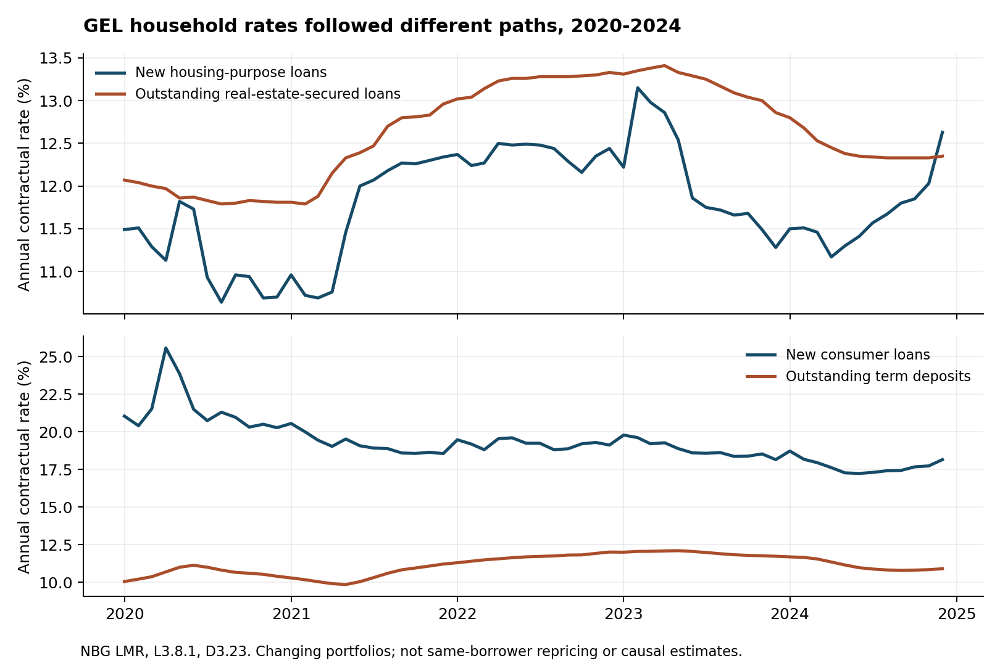
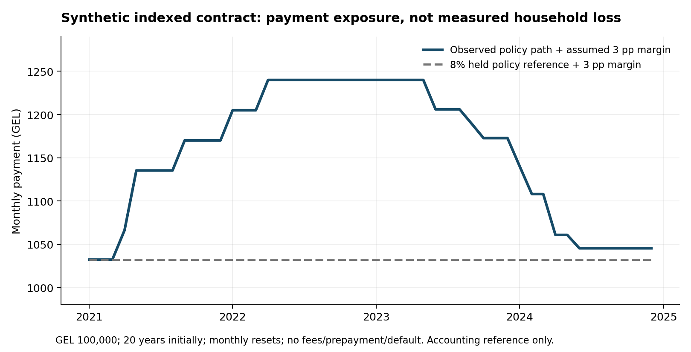
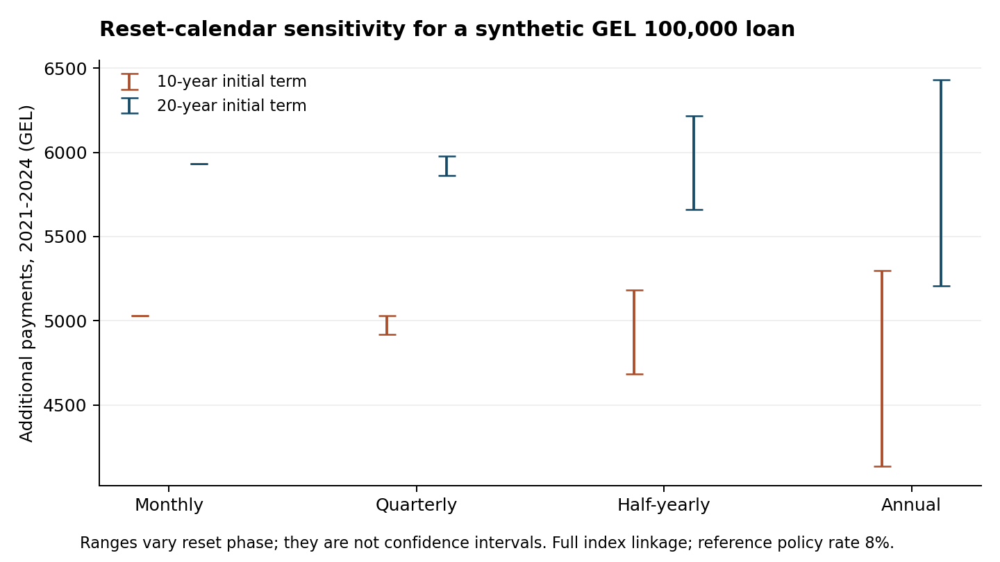

# რატომ და როგორ გვაღარიბებს ეროვნული ბანკი?

## Household credit pricing and conditional debt-service exposure in Georgia, 2020–2024

**Discussion paper v0.1 | 8 November 2026 | For external methodological and substantive review**

**Nikoloz Oniani**

GeorgianNationalBank research project. Public-facing title: “Why and how does the National Bank make us poorer?” The title expresses the investigation's critical question, not a finding of net policy-induced impoverishment. This paper provides the first credit-channel chapter of that investigation. The companion accountability dossier covers the other mechanisms, institutional powers and reforms.

## Abstract

We construct an auditable monthly dataset of Georgian household credit and deposit conditions and quantify debt-service exposure under explicitly specified loan contracts. Seven official National Bank of Georgia (NBG) workbooks yield 46 series and 2,760 observed monthly values for January 2020–December 2024. All 360 tested accounting identities reconcile within GEL 0.01 million. New GEL housing-loan rates increased from 10.70% in December 2020 to 12.44% in December 2022, while new GEL consumer-loan rates decreased from 20.28% to 19.13%; outstanding GEL term-deposit rates increased from 10.41% to 12.02%. A standardized GEL 100,000, 20-year annuity priced at the housing-loan averages has a GEL 120.06 higher monthly payment at the December 2022 rate. A separate synthetic policy-indexed contract, with an assumed three-point margin and monthly resets, produces GEL 5,933.06 additional payments during 2021–2024 relative to an unchanged 8% policy-rate accounting reference, accompanied by GEL 1,179.29 additional terminal debt. These are conditional exposure calculations, not observed borrower payments, estimates of monetary-policy causality or net welfare losses. Public aggregates lack the linked currency, reset, balance and income information needed for population attribution. The findings support differentiated borrower/depositor analysis and targeted disclosure, while rejecting an undifferentiated claim that every household credit price rose.

## 1. Question and contribution

The narrow question is: **what do verified Georgian credit prices and a documented policy-rate history imply for the debt-service exposure of specified household contracts?** A separate, harder question is whether the NBG's choices made households worse off than a feasible alternative policy. We answer the first with observed statistics and transparent accounting. We do not claim to answer the second.

This distinction matters politically. A loan payment can rise while monetary policy prevents still larger losses from inflation or currency instability. Borrowers and depositors need not be the same people. A larger payment can reflect interest expense, principal repayment, or both. An institution's ability to affect financing conditions creates a responsibility to explain these tradeoffs; it does not establish that every adverse outcome was caused by that institution.

The contribution is an executable, cell-traceable dataset and a reviewable contract-exposure analysis. It extends the repository's validated policy panel and partial 2017 household inflation pilot without repeating them. We provide observed outcomes that contradict a uniform-cost narrative, controlled arithmetic that demonstrates a genuine possible burden, and exact limits on translating the latter into a national estimate. No causal regression, invented instrument or household-level linkage is used.

## 2. Data, scope and validation

### 2.1 Sources and units

NBG's public statistics catalog identifies the workbooks used here. Files were acquired on 8 November 2026; the catalog lists an update date of 26 October 2026 for these tables. This is a current-vintage reconstruction of historical observations, not a real-time information set. Original URLs, SHA-256 hashes, byte sizes and acquisition outcomes are in `sources.json` and `acquisition_log.json`. Every extracted observation retains source ID, sheet, numeric cell, date cell and source-file hash in `credit_observations.csv`.

| Source | Core use | Population / measurement |
|---|---|---|
| L3.6 | Outstanding household loans and rates, GEL and FX | Resident and nonresident households separately; includes individual entrepreneurs |
| L3.12 | Independent reconciliation of resident household stocks | Resident households; currency-specific stocks |
| LPR | Household loan-purpose stocks | Resident and nonresident households; business-purpose borrowing included |
| LMR | New housing and consumer loan rates | Resident and nonresident households; monthly principal-inflow-weighted contractual rates |
| L3.8.1 | Real-estate-secured household loan rates and amounts | Collateral definition; broader than housing-purpose borrowing |
| D3.23 | Household deposit stocks and term-deposit rates | Resident and nonresident households; includes individual entrepreneurs |
| D3.22 | New term-deposit rates | Household deposit inflows; distinct from outstanding deposit rates |

Stocks are month-end principal amounts in **GEL million**. Foreign-currency stocks are converted to GEL at end-month official exchange rates, so changes include exchange-rate translation. Rates are annual contractual percentages, not effective annual percentage rates inclusive of fees. NBG's workbook notes exclude zero-interest contracts from rate calculations. Consequently, multiplying an unadjusted total stock by the published weighted rate need not recover even a comparable annualized interest amount. We do not calculate a national interest bill that way.

“Households” in banking statistics includes individual entrepreneurs and, in several tables, nonresidents. It is not interchangeable with the population of resident consumption-survey households. We preserve the residency distinction in L3.6 and label the wider population in LMR, LPR and deposit statistics. A new housing-purpose loan rate is not an outstanding mortgage rate; a real-estate-secured loan can finance purposes other than housing. [L3.6; L3.8.1; LMR; LPR; D3.23; D3.22]

The published calendar specifies the 25th day after the reference month, moved to the next working day when necessary. Historical first-release timestamps and revisions were not reconstructed. LMR begins with the October 2015 statistical-system change. LPR records a September 2022 institutional/business-size classification change; purpose-specific business comparisons across it require care. LMR and LPR explicitly introduce microbanks from January 2025. The primary sample ends in December 2024, avoiding that stated expansion. No assertion is made that these notes exhaust every historical revision.

### 2.2 Integrity and accounting

Acquisition validates XLSX ZIP structure and requires `ZipFile.testzip()` to return `None`. Processing refuses source hashes that differ from the reviewed vintage, checks header labels before selecting cells, rejects duplicate month keys, and retains missing observations rather than assigning zero. There are no missing values in the selected 46 series over the 60-month primary period.

Three identities are checked in each month and currency: the sum of seven LPR purpose categories equals the LPR household total; L3.6 resident plus nonresident household stocks equal that total; and L3.6 resident stocks equal the independently tabulated L3.12 household sector. All 360 checks pass within GEL 0.01 million, a tolerance allowing rounding of stocks reported to GEL 0.001 million. This tests extraction and internal agreement, not the truth of every underlying bank submission or the independence of tables drawn from a common reporting system.

The consumer-credit workbook L3.14 was acquired but is not used in the core extraction. It also covers households, but reports outstanding consumer-credit stocks and rates, whereas the consumer-price comparison here uses LMR's new-loan flow rates. Those measures are not interchangeable. Two financial-stability reports and the interest-rate methodology provide interpretation. No confidential records or new household microdata were acquired. The existing household pilot, raw-data provenance and prior reports remain unchanged.

## 3. Methods and estimands

### 3.1 Observed credit prices

We report December 2020, 2022 and 2024 endpoints and plot all monthly observations. These dates summarize the start, tightening and easing portions of the study window; they are not selected to maximize a causal coefficient. December 2020 is also the pre-path baseline for the synthetic 2021–2024 contract. January–November 2020 observations remain in the dataset and figures. Endpoint differences are in percentage points. They are **differences between changing weighted portfolios**, not within-borrower rate changes or pass-through coefficients.

Observed rate changes can reflect monetary transmission, borrower risk, bank competition, fixed/floating composition, maturity, subsidies, refinancing and selection into new lending. The aggregate data do not separate those mechanisms. We estimate no regression of loan rates on the policy rate: an endogenous policy response and changing loan composition would make a causal interpretation unjustified.

### 3.2 Standardized new-loan exposure

To translate observed prices into an understandable unit, we calculate payments on a synthetic level-payment loan with principal P, remaining months n and monthly interest r equal to the published nominal annual rate divided by 12:

`A(P,r,n) = P*r / (1 - (1+r)^(-n)); A(P,0,n) = P/n.`

The headline illustration uses GEL 100,000 and 240 months. Size and maturity are assumed, not estimated as representative. The full grid uses GEL 50,000/100,000/200,000 and 120/240 months. Fees, insurance, prepayment and eligibility restrictions are absent. Holding size and term constant removes those differences from the illustration; it does not eliminate composition differences in the source average rate. This estimand is a standardized financing-price exposure, not realized payment change for an observed household.

### 3.3 Synthetic indexed-contract path

We separately simulate an annuity with GEL 100,000 outstanding on 1 January 2021, an initial remaining term of 240 months, and an assumed fixed margin of three percentage points over the NBG policy rate. The policy rate effective at the **start** of each reset month determines the contractual rate. Decision and enforcement dates are kept distinct using the previously validated NBG decision file. Monthly resets therefore apply the March 2022 tightening from April, rather than using information not available on 1 March.

At each monthly payment, interest is the opening balance times the annual contractual rate divided by 12. Payments are recalculated over the remaining original term. Until the next reset, the contractual rate stays fixed. No margin changes, caps, floors, fees, prepayments, arrears, defaults or payment holidays are assumed. The comparison contract holds the reference policy rate at December 2020's 8%, plus the same margin. The reference is an accounting device; it is **not a claim that maintaining an 8% policy rate was feasible or welfare-improving**.

Sensitivity cases vary initial maturity, monthly/quarterly/half-yearly/annual resetting, all reset-month phases, and a coefficient of 0, 0.5 or 1 on benchmark changes. These coefficients are assumptions, not estimated transmission. A separate comparison uses a 9% held policy reference to expose dependence on the reference choice. We report cumulative payment differences, interest differences and terminal debt separately:

`additional payments = additional interest - additional terminal principal.`

Both contracts start with the same principal. Treating additional cash payments alone as a complete financing-cost or welfare measure would omit differences in debt still owed. We do not discount these nominal cash flows into a welfare metric or extrapolate beyond December 2024.

## 4. Results

### 4.1 Borrowing and saving prices did not move uniformly

| Annual rate (%) | Dec 2020 | Dec 2022 | Dec 2024 | 2020–22 change (pp) |
|---|---:|---:|---:|---:|
| New GEL housing-purpose loans | 10.70 | 12.44 | 12.63 | +1.74 |
| New GEL consumer loans | 20.28 | 19.13 | 18.16 | −1.15 |
| Outstanding GEL real-estate-secured household loans | 11.81 | 13.33 | 12.35 | +1.52 |
| Outstanding GEL loans to resident households, all purposes | 16.39 | 16.57 | 15.36 | +0.18 |
| Outstanding GEL household term deposits | 10.41 | 12.02 | 10.91 | +1.61 |
| New GEL household term deposits | 9.36 | 12.06 | 11.02 | +2.70 |

Sources: LMR, L3.8.1, L3.6, D3.23 and D3.22; machine-readable Table 1. The household populations differ as described in Section 2. Rates are nominal contractual rates. Depositor rate improvements are not net real returns, and depositors cannot be matched to borrowers from these tables.

The housing and collateralized-loan series show higher financing prices during tightening. The consumer series supplies clear counterevidence to the claim that all household lending prices increased. Neither direction identifies monetary-policy causality. In December 2024 the policy rate had returned to 8%, but the new housing-loan average remained above December 2020's. This divergence demonstrates why a simple one-for-one mapping from the policy rate to every retail rate is inadequate; it does not identify bank conduct or a policy mistake.

Resident household GEL loan stocks increased from GEL 11,367.09 million in December 2020 to GEL 24,095.56 million in December 2024; FX stocks expressed in GEL increased from GEL 7,383.13 million to GEL 7,642.07 million. [L3.6; Table 1] These are balances, not borrower counts, disposable income or policy-caused credit growth. We do not use them to scale the synthetic indexed-loan result because the relevant indexed share and reset exposure are not jointly observed.

### 4.2 Standardized housing-loan payment exposure

| Pricing month | Observed new housing rate | Synthetic monthly payment | Difference from Dec 2020 |
|---|---:|---:|---:|
| Dec 2020 | 10.70% | GEL 1,011.85 | — |
| Dec 2022 | 12.44% | GEL 1,131.91 | GEL 120.06 |
| Dec 2024 | 12.63% | GEL 1,145.32 | GEL 133.47 |

Source: LMR rates and annuity calculation; Table 2. Principal GEL 100,000 and term 20 years are assumptions. These figures quantify a change in financing prices for a standardized loan. They do not demonstrate that an existing borrower's payment rose by these amounts. Lower consumer-loan rates, different margins or terms, and changing incomes could offset or reinforce a particular household's burden.

### 4.3 Policy-indexed contract exposure

In the main synthetic contract, the initial payment is **GEL 1,032.19**. The highest payment is **GEL 1,239.94**, first reached in April 2022, an increase of **GEL 207.75** relative to the held-rate comparison. During January 2021–December 2024, additional payments total **GEL 5,933.06**; additional interest is **GEL 7,112.35**; and additional debt remaining at the end is **GEL 1,179.29**. The three numbers reconcile exactly before rounding. They are nominal amounts for one synthetic contract, not population estimates.

After the benchmark returns to its reference level, the synthetic payment remains somewhat higher because earlier high interest reduced principal amortization relative to the comparison contract. The end-period payment is GEL 1,045.27. This persistence is an accounting consequence of the assumed amortization rule, not independent evidence of a lasting causal welfare effect.

### 4.4 Reset and reference sensitivity

| Reset interval | Additional payments, 10-year initial term | Additional payments, 20-year initial term |
|---|---:|---:|
| Monthly | GEL 5,031 | GEL 5,933 |
| Quarterly, all phases | GEL 4,918–5,032 | GEL 5,863–5,980 |
| Half-yearly, all phases | GEL 4,682–5,184 | GEL 5,662–6,217 |
| Annual, all phases | GEL 4,135–5,297 | GEL 5,206–6,432 |

Source: Table 3; GEL 100,000, full benchmark linkage, three-point margin and 8% held reference; January 2021–December 2024. Ranges vary reset phase, not sampling uncertainty. Delayed resetting can postpone both increases and decreases, so its effect on cumulative payments is not necessarily monotonic.

With zero linkage to benchmark changes, the extra payment is zero by construction. Half linkage produces a different conditional path, retained in the full sensitivity CSV. Changing only the held policy reference from 8% to 9% reduces the main cumulative payment difference to **GEL 2,625.97**. This marked reference dependence is why none of these totals should be called an identified “cost of NBG policy.” A valid alternative-policy comparison would also change inflation, income, employment, exchange rates and default risk.

For illustrative monthly incomes of GEL 3,000, 6,000 and 9,000, the same peak additional payment corresponds to **6.92, 3.46 and 2.31 percentage points of income**, respectively. [Table 4] These are equal-debt arithmetic scenarios, not observed income groups, approval-eligible borrowers, survey quintiles or estimates of actual incidence. Distributional measurement requires the joint distribution of debts, contractual terms, deposits and income.

## 5. What the results do and do not establish

**Observed finding:** new housing-loan and outstanding collateralized-loan prices rose over the stated tightening comparison while new consumer-loan prices fell and deposit rates rose. **Conditional finding:** a contract indexed to the observed policy rate can impose a substantial cash-flow burden during tightening, with timing dependent on resetting and amortization. **Unresolved finding:** the population burden, its income distribution and the net welfare sign of policy are not identified.

The NBG's 2024 Financial Stability Report discusses an adjustable-rate share of 42% in its household section (p.23). Its broader banking discussion reports variable-rate shares of 43% for GEL and 52% for FX loans (p.50). These are different reporting populations, and the household passage supplies no currency-by-reset cross-tab. We do **not** multiply the all-bank GEL share by household balances or the household all-currency share by GEL balances. The report also describes improving real wages and potential debt-service relief from easing; these are relevant counterevidence to a universal impoverishment claim. [FSR2024]

The previously reviewed IMF 2025 structural exercise finds short-run benefits from intervention in its model. That evidence remains relevant to the wider investigation, but it is not an estimate of the benefit offsetting each synthetic borrower's payment in this paper. [IMF2025, paragraph 29] Borrowers can benefit from lower inflation or FX stabilization, savers from nominal returns, and all households from reduced crisis risk. Conversely, employment or income effects can increase costs. None can be summed here without additional evidence and explicit welfare weights.

Several limitations are decisive. Aggregate rate averages change with portfolio composition. Contractual interest is not actual cash collection during deferrals or default. The simulation omits refinancing, fees, floors and behavioral responses. A nominal cash-flow difference does not measure poverty, consumption loss or compensating variation. No sampling confidence interval is attached to deterministic arithmetic; uncertainty lies in data revisions, aggregation, missing contract terms and assumptions. Reset sensitivity is neither a confidence interval nor a rigorous bound on total policy harm.

The 2017 household pilot remains a separate partial price-exposure exercise. Its unmatched consumption categories and missing linkage to credit contracts preclude attaching these debt-service results to its expenditure quintiles. We do not treat independent annual household samples as a panel or relabel a partial CPI contribution as total household inflation. [PILOT2017]

## 6. Accountability implications and falsifiability

The evidence justifies a specific disclosure request, not an immediate prescription to raise or lower the policy rate. Publish anonymized joint distributions of household loan balances by residency, currency, purpose, fixed/floating/hybrid type, benchmark, reset frequency and remaining maturity. Add income and debt-service bands with safeguards against identifying customers. Report the corresponding deposit exposure where legally feasible, together with definitions and revision histories. This would make a distributional annex materially more informative than an average credit rate alone.

For contractual attribution, obtain linked histories of balances, rates, reset dates, actual payments, fees, arrears, refinancing and verified incomes. Reconstruct what each contract would mechanically require under declared benchmark paths; validate against actual billed payments. For a causal policy study, predictable reset timing is only a candidate source of exposure variation: contract selection, anticipation, refinancing and macro shocks must be addressed before treating it as exogenous. Fixed-rate borrowers are not automatically a valid control group. No such design is claimed here.

Three findings would change the public case. First, if most relevant balances were fixed or did not reset during tightening, population exposure would be much smaller than an all-indexed scenario. Second, if linked income and asset gains offset increased debt service, a net-household impoverishment claim would fail even where interest costs rose. Third, if credible policy counterfactuals show larger avoided inflation or crisis losses, tightening could be beneficial despite identifiable borrower costs. These outcomes must remain admissible.

## 7. Conclusion

The study documents heterogeneous Georgian credit prices and a reproducible mechanism through which indexed borrowing can transmit policy-rate increases into household cash-flow pressure. It does not establish that NBG policy made Georgians poorer on balance. The strongest supported critical claim is narrower: burdens can be concentrated and material, while currently assembled aggregate data cannot identify who bore them or whether they were justified by benefits. Public accountability should require a transparent explanation of those tradeoffs and appropriately protected data that permit their assessment.

## Data availability, declarations and replication

All normalized observations, cell provenance, source hashes, scripts, tests, figures and sensitivity outputs are included in the repository. Provider XLSX/PDF files are retrieved into ignored `data/raw/peer_review/`; their verified URLs and hashes are committed. No personal records are redistributed. The core calculations reproduce offline from committed CSVs; full extraction requires the pinned provider files or a reviewed replacement vintage. Network unavailability does not prevent reviewing the committed results.

Run `python src/credit_analysis.py` for tables and paths, `python src/credit_figures.py` for figures, and `python -m unittest discover -s tests -v` for tests. Run `python src/credit_acquire.py` then `python src/credit_extract.py` to audit source extraction. The reviewer packet documents package versions, checks and exact input hashes. The starting research commit is `89bbc62a1e2d3dc1fd786568460c39bc431c6cf7`.

Author: Nikoloz Oniani, as designated by the project owner. This draft was prepared with AI assistance for acquisition code, calculations and writing. It has not undergone independent external peer review. Institutional affiliation, funding and competing-interest declarations remain to be supplied by the author. No human participant recruitment or new confidential microdata collection occurred. Reviewers are asked to assess the descriptive and conditional estimands actually claimed, not an absent causal poverty estimate.

## References and precise locators

The accompanying [source register](Sources.md) contains exact official download links and SHA-256 hashes. IDs used above map as follows:

- **L3.6:** NBG, Outstanding Loans of Banks by Debtors. `NC-loan(E)` and `NC-%(E)`, columns F/G; analogous FC sheets. Resident/nonresident household stocks and contractual rates. Notes rows 3, 6–8.
- **L3.12:** NBG, Loans by Sectors. `Total NC` and `Total FC`, column H. Reconciliation of resident household stocks.
- **LPR:** NBG, Loans by Purpose. `HH`, row 3 dates; rows 4, 6–13 and 15–21. Purpose stocks; footnotes at rows 27–29.
- **LMR:** NBG, Interest Rates on Loans to Households by Loan Types, Issued During Reporting Period. `Loans_NC`/`Loans_FC`, row 3 dates, housing row 4, consumer row 22. Notes and rows 43–45.
- **L3.8.1:** NBG, Loans Secured by Real Estate. Amount/rate sheets, household columns I/Q/Y/AG. Collateral-based scope.
- **D3.23:** NBG, Deposits of Individuals. NC/FC household sheets; total stock B, term stock E, term rate N. Notes define resident/nonresident coverage and zero-rate exclusion.
- **D3.22:** NBG, Market Interest Rates on Term Deposits. Household GEL column E and FX column H; flow-weighted rates.
- **FSR2024:** NBG, Financial Stability Report 2024, household analysis pp.22–23 and banking-sector discussion p.50. The report was announced 25 September 2024; this is not a year-end household contract census.
- **FSR2023:** NBG, Financial Stability Report 2023, p.58. Currency-specific floating-rate shares refer to the broader banking portfolio and are not used as household weights.
- **RATE:** NBG historical monetary-policy decision/enforcement workbook, preserved in the repository's source manifest and `nbg_policy_decisions_2008_onward.csv`.
- **IMF2025:** IMF Country Report 25/217, Georgia: Selected Issues, intervention chapter, paragraph 29 and following qualifications; preserved prior benchmark report.
- **PILOT2017:** Repository, `reports/Pilot2017_Methods_and_Results.md`, `pilot2017_validation.json` and `pilot2017_exposure.csv`. Used only to delimit what can be linked, not to generate new credit incidence.
