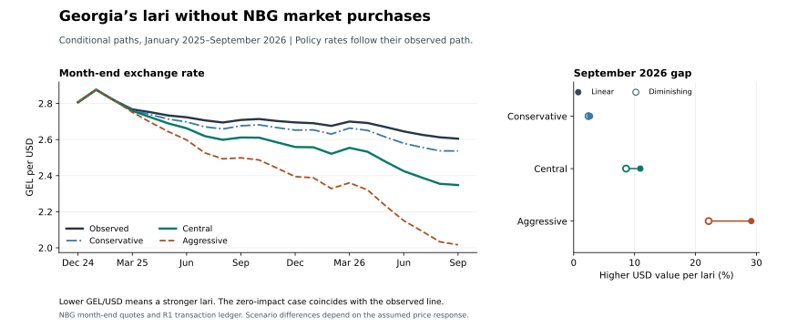

# The lari without NBG market purchases, January 2025–September 2026

**Fixed policy-rate calculation · 24 November 2026.** The observed September 2026 exchange rate was **2.6051 GEL per US dollar**. Removing the minimum gross purchase leg gives **2.3481** in the central calibration. A lari would buy **10.95% more USD** at that endpoint. Across the 21 month-ends, its average purchasing gain against the dollar is **4.85%**. With diminishing price impact from sustained purchases, the central endpoint is **2.3987**, an **8.61%** gain. These percentages concern currency conversion. Household prices and welfare require additional channels. [All monthly results](monthly.csv) · [Endpoint calculations](endpoints.csv)

| Calibration | Impact in log points per purchase of 1% of annual GDP | Half-life, months | September GEL/USD | Higher USD value per lari in September | Mean monthly gain in USD per lari |
|---|---:|---:|---:|---:|---:|
| Conservative | 0.47825 | 3 | 2.5367 | 2.69% | 1.41% |
| Central | 0.9565 | 10 | 2.3481 | 10.95% | 4.85% |
| Aggressive | 1.913 | 20 | 2.0169 | 29.17% | 11.93% |
| Zero direct impact | 0 | — | 2.6051 | 0.00% | 0.00% |



From the common December 2024 opening to September 2026, the observed USD value of one lari rose **7.74%**. In the central no-purchases case it rises **19.54%** over the same period. In January and February 2025, net purchases were zero and the three reference paths coincide with the observed rate. By December 2025 the central path reached **2.5588**, versus **2.6951** observed. It weakened from **2.5214** to **2.5541** between February and March 2026, when there was a net sale and the effect of earlier purchases continued to decay. Net buying subsequently resumed. The sign of the extra appreciation follows from the positive purchase responses imposed in the three cases. The data establish when the NBG bought FX and the lari's observed path. Georgian purchase and quote histories leave the magnitude and persistence open. [Monthly paths](monthly.csv) · [Georgian historical evidence](../r3_fx_response/README.md)

## How to reproduce the comparison

**Observed inputs.** Start both paths at 2.8068 GEL/USD on 31 December 2024. Use NBG's official quote valid at each calendar month-end. R1 records **USD 5,803.15m net purchases** over the window. At instrument level, observed auction legs plus the positive and negative parts of the non-auction net series give **USD 5,819.35m minimum purchases** and **USD 16.20m minimum sales**. All episode auction amounts are zero. The sale falls in March 2026. The reference cases remove the purchase leg and retain the sale. Two-way non-auction trading within a month is unobserved. The gross-flow lower bound applies to the input quantity only. Use the locked 2024 World Bank nominal GDP of **USD 34,189.423333141m** to scale flows throughout. [R1 ledger and workbook cells](../r1_2026_11_10/episode_transaction_ledger.csv) · [Gross flow bounds](../r1_2026_11_10/gross_flow_accounting_bounds.csv) · [Official daily quotes](../../data/derived/episode_2026_11_09/official_fx_daily.csv) · [GDP observations](../../data/derived/r3_reopen_2026_11_16/gdp_observations.csv)

**Calibrated response.** Let $P_t$ be removed purchases in USD millions, $G$ annual USD GDP in millions, $H$ the half-life in months, and $\beta$ the registered impact in log points. With sales common to both paths, $D_t$ is the log-point contribution of purchases to the observed quote. At the December 2024 opening $D_0=0$.

$$
D_t=2^{-1/H}D_{t-1}+\beta\frac{100P_t}{G},\qquad
E_t^{\mathrm{without}}=E_t^{\mathrm{observed}}\exp(-D_t/100).
$$

The reported gain is $100(E_t^{\mathrm{observed}}/E_t^{\mathrm{without}}-1)$. Changing the denominator gives a different percentage. At the central September endpoint the **GEL price of one dollar is 9.87% lower**, while the **USD value of one lari is 10.95% higher**. The March 2025 purchase of USD 101.7m illustrates the units. It was 0.29746% of frozen annual GDP and generated 0.28452 log points of central impact, taking the observed 2.7673 to 2.7594. The aggressive coefficient and half-life come from the published cross-country nominal response. The lower weights and shorter persistence are the study's registered judgments. No part of the grid was fitted to the episode endpoint. [Protocol, section 2](../../research/PROTOCOL.md) · [Adler, Lisack and Mano, Table A11 column 4](https://www.imf.org/-/media/websites/imf/imported-full-text-pdf/external/pubs/ft/wp/2015/_wp15130.pdf)

**Policy and expectations.** Fixed monetary policy means that observed and alternative policy rates agree in every month, including the rise from 8.00% to 8.25% in May 2026. The expected rate differential between the paths is also zero. Assume that the NBG accommodates GEL liquidity at that rate and private portfolios absorb the missing official demand according to the stated impulse. Common external shocks, fiscal flows and other price movements are carried by the observed quote. The direct effect starts in the purchase month. This assumes no independent advance repricing, reserve-confidence effect or change in emergency sales. A sensitivity allows the observed March sale to lapse in the stronger-lari scenario. These assumptions isolate the direct FX channel. [Observed monetary and exchange-rate inputs](../r3_reopen_2026_11_16/model_panel.csv)

## What changes the endpoint?

| Change from the reference assumptions | September GEL/USD | Higher USD value per lari |
|---|---:|---:|
| Diminishing impact, conservative | 2.5431 | 2.44% |
| Diminishing impact, central | 2.3987 | 8.61% |
| Diminishing impact, aggressive | 2.1324 | 22.17% |
| Central impact with a three-month half-life | 2.4702 | 5.46% |
| Central impact with the alternative USD 38.1bn GDP scale | 2.3732 | 9.77% |
| Full published Table A11 lag response at aggressive impact | 2.0600 | 26.46% |
| Central with an additional USD 10m bought and sold each month | 2.3406 | 11.30% |
| Central if the alternative omits the USD 16.2m March sale | 2.3488 | 10.91% |

**Diminishing impact.** The highest positive monthly net purchase in 2020–24 was 1.05% of that year's GDP. Seven episode months exceeded that share on the registered GDP scale, reaching 1.85% in May 2026. The published paper's Table 1 reports a 3.77% monthly maximum for its cross-country FXI/GDP proxy. The extrapolation here concerns repeated large trades and their persistence in Georgia. A single cross-country maximum cannot validate that sequence.

For this sensitivity let $z_t=2^{-1/H} z_{t-1}+100 n_t/G_t$, where $n_t$ is signed net market demand from the NBG. Start at zero just before January 2020 and carry the common December 2024 state into each world. Historical flows use their own year's GDP. Choose $K$ as the largest absolute pre-episode state, with a minimum scale of one percentage point of GDP. Up to $K$ the response is linear. Beyond it the marginal impact declines in proportion to $K/|z|$. Apply the same curve to each world's whole trading history, using the difference $\beta[f(z_t^{\mathrm{observed}})-f(z_t^{\mathrm{without}})]$.

$$
f(z)=\begin{cases}
z & |z|\le K,\\
\operatorname{sgn}(z)K[1+\log(|z|/K)] & |z|>K.
\end{cases}
$$

The historical thresholds are **3.32, 4.66 and 5.67** percentage points of GDP in conservative, central and aggressive order. The central case first crosses its threshold in December 2025. The threshold observations come from Georgian data. The curvature is an illustrative assumption about investors absorbing repeated orders. Shortening the central half-life alone reduces the endpoint gain to 5.46%, a larger change than this particular saturation rule. The USD 10m paired-flow check is another explicit assumption. Adding equal purchases and sales retains the observed net in every month and increases the gross purchases removed. No nonnegative hidden pair can reverse the sign in the positive linear cases with sales held common. [Monthly sensitivities](sensitivities.csv) · [Published impulse weights](../r3_reopen_2026_11_16/external_kernels.csv)

**Settlement check.** Carry the difference between observed and simulated net acquisitions in USD, with the balance difference carried in from the preceding month earning interest at monthly mean SOFR divided by 1,200 (SOFR in annual percent). Apply the current flow at month-end. Hold other USD-equivalent flows, valuations and the composition of unaltered assets common. Subtract the missing lots plus their proxy income from both gross reserves and the published deposit-plus-FX-securities account, which includes signed negative other positions. The latter assumes the FX assets can settle at their reported value. All 21 reference month-ends clear a zero floor. The September alternative has **USD 2,209.19m gross** and **USD 684.78m** in the conditional liquid account, the latter's lowest month-end. These balances are common to the three exchange-rate calibrations because the removed USD cash flows are the same. Encumbrances, currency matching, intramonth calls and GEL funding costs remain outside this check. [Asset definitions and stocks](../reserve_buffer_policy/README.md) · [Reserve and SOFR inputs](../r3_reopen_2026_11_16/model_panel.csv)

The numerical release covers the direct channel at fixed policy rates. An endogenous rate response, a reserve-adequacy verdict and national welfare have separate evidence requirements. The spread across calibrations has no statistical coverage probability.

## Replication

From the repository root, run the following commands with the [existing Python environment](../../replication/requirements-r3-reopen.txt). The first checks both CSV content and the chart byte for byte. Omit `--check` to regenerate them. The tests independently sum each month's intervention impulses, check official month-end quotes and instrument legs, and verify the nonlinear response and reserve arithmetic.

```sh
python src/r3_fixed_rate.py --check
python -m unittest discover -s tests -p test_r3_fixed_rate.py
```

A direct check against the SHA-256-locked NBG market workbook, both NBG quote workbooks and the World Bank GDP file matched all 21 monthly inputs. Buy and sell sheets are joined by reporting month. For February 2025 their date labels differ within the month. Independently summing the dated monthly impulses reproduced all 63 reference quotes to the CSV rounding precision (maximum difference below 0.0000000005 GEL/USD). [NBG source manifest](../../data/source_manifest.json) · [GDP source manifest](../../data/r3_reopen_source_manifest.json)
