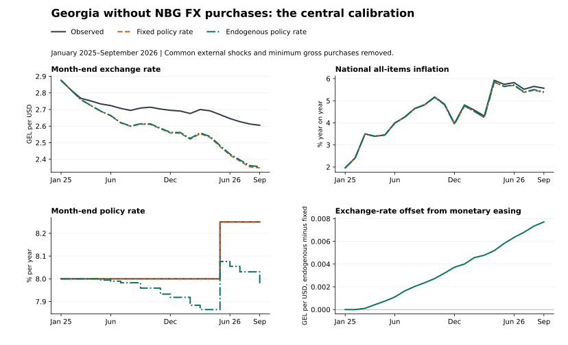

# The lari, inflation and the policy rate without NBG purchases

**January 2025–September 2026 · Conditional structural simulation · 24 November 2026**

The central calibration gives **2.3558 GEL per USD in September 2026**, against **2.6051 observed**. One lari buys **10.58% more dollars** without the purchases. At the actual policy rate, the same calculation gives **2.3481** and **10.95%**. Lower expected inflation allows a lower policy rate. The prospect of that easing gives back **0.36 percentage points** of the currency gain. National annual inflation reaches **5.40%**, against **5.57%** reconstructed from Geostat, and the policy rate reaches **7.98%**, against **8.25%** observed. [Monthly observations and simulations](monthly.csv) · [Endpoint and period averages](endpoints.csv)

| September 2026 | GEL/USD, fixed → endogenous rate | USD gain per lari, fixed → endogenous | Annual headline inflation, fixed → endogenous | Policy rate, fixed → endogenous | Mean monthly USD gain, fixed → endogenous |
|---|---:|---:|---:|---:|---:|
| Conservative | 2.5367 → 2.5367 | 2.69% → 2.69% | 5.57% → 5.57% | 8.25% → 8.25% | 1.41% → 1.41% |
| Central | 2.3481 → 2.3558 | 10.95% → 10.58% | 5.37% → 5.40% | 8.25% → 7.98% | 4.85% → 4.70% |
| Aggressive | 2.0169 → 2.0517 | 29.17% → 26.97% | 4.82% → 4.98% | 8.25% → 6.88% | 11.93% → 11.11% |

The gain uses the dollar purchasing power of a lari, measured as 100 times the observed quote divided by the counterfactual quote, less 100. Inflation is the national all-items percentage change from the same month a year earlier. The three columns of assumptions carry no probability weights. The conservative case imposes zero appreciation pass-through, so its policy rate follows the observed rate even as its lari strengthens. [Protocol, sections 2–3](../../research/PROTOCOL.md)



## What happens during the episode

There is no difference in either economy in January or February 2025. In March, the first USD 101.7m purchase moves the central no-purchases quote immediately. The March meeting precedes receipt of the full monthly amount. Its rate and that month's CPI therefore still coincide with the observed values. The first rate response comes at the May meeting. By December 2025 the endogenous path is **2.5625 GEL/USD**, **3.94% inflation** and a **7.92%** policy rate. Common shocks include the observed May 2026 tightening. The central alternative also tightens in May, from **7.86% to 8.08%**, even though its rate stays below the observed one. Monetary feedback does not mechanically prescribe a cut at every meeting. [Monthly paths and meeting forecasts](monthly.csv)

At the September 2026 meeting the central forecast places annual inflation twelve months ahead **0.3584 pp below** its common-shock baseline. With two months since the July decision, the rule gives a **0.2749 pp** lower September rate. At September month-end, expected rate differences over the following year add **0.3278 log points** to GEL/USD, weakening the simulated lari relative to the fixed-rate case. The central September annual inflation gap is **−0.1661 pp**. The FX component is **−0.1900 pp** and the domestic response to easing adds **0.0239 pp**. These are changes in the inflation rate. They do not measure the reduction in the cost of a particular household's basket. [Monthly decomposition](monthly.csv)

## Observations, assumptions and dating

| Input | Evidence and use |
|---|---|
| FX, interventions and initial reserves | Observed NBG calendar month-end GEL/USD quotes and R1 instrument-level monthly net flows. As in the completed calculation, the minimum gross convention removes USD 5,819.35m of purchases and retains USD 16.20m of sales. Gross two-way non-auction trading is unobserved. The 2024 annual GDP denominator is fixed at USD 34,189.4233m. [R1 bounds](../r1_2026_11_10/gross_flow_accounting_bounds.csv) · [Fixed-rate calculation](../r3_fixed_rate/README.md) |
| Headline CPI | Observed national “Total” in row 5 of Geostat's “Georgia” sheet, previous month = 100. The committed extract has 33 consecutive monthly relatives, January 2024–September 2026, from the existing October 2026 workbook vintage. Multiplying twelve consecutive relatives and subtracting one gives the observed y/y rate as a fraction. All 21 episode rates round to the values in Geostat's September bulletin, page 6, upper chart. September's 5.56825% rounds to the published 5.6%. These ex-post observations supply the common baseline. The MPC never receives subsequent CPI observations as forecasts. [Extract](../../data/derived/r3_policy_feedback/episode_headline_relatives.csv) · [Workbook and source hashes](../../archive/legacy/reports/nbg_source_manifest.json) · [Geostat bulletin of 2 October](https://www.geostat.ge/media/83212/Inflation-Rate-in-Georgia%2C-September-2026.pdf) |
| Monetary policy | Observed dates of all 14 decisions and their effective dates and rates agree with the hash-pinned NBG MPIR workbook. Eight meetings occurred in 2025 and six through September 2026. Effective and decision dates fall in the same month throughout. The model uses the actual meeting opportunities and treats their schedule as predetermined. Beyond the observation window, it repeats February, March, May, June, July, September, October and December for forecasts. These are projected opportunities. Individual rate gaps are continuous target-rate equivalents. [Decision history](../../archive/legacy/reports/nbg_policy_decisions_2008_onward.csv) · [NBG calendar](https://nbg.gov.ge/en/monetary-policy/committee-meeting-calendar) |
| FX impact and persistence | Registered elasticities of 0.47825, 0.9565 and 1.913 log points per 1% of GDP, and half-lives of 3, 10 and 20 months. The aggressive pair transfers published cross-country evidence. The lower pairs impose attenuation. Private portfolios absorb the missing official order at these prices. The price effect of sustained Georgian market purchases remains uncertain. [Fixed-rate parameter sources](../r3_fixed_rate/README.md) · [Pre-2025 Georgian diagnostics](../r3_fx_response/README.md) |
| Inflation and the policy rule | The total 24-month FX-shock disinflation targets are 0, 0.25 and 0.50 pp. The IMF benchmark is a Georgian risk-sentiment **depreciation** shock. Transferring it to a purchase shock and allowing for weaker appreciation pass-through are calibration judgments. Corresponding long-run policy slopes are 1.1, 1.5 and 2.0 pp per pp of forecast inflation. Quarterly smoothing is 0.75. NBG describes weaker pass-through from appreciation and supplies the rule's form. Georgian meeting-history coefficients proved unstable across samples. [IMF 2025, paragraph 19 and Figure 13](https://www.imf.org/-/media/files/publications/cr/2025/english/1geoea2025002-source-pdf.pdf) · [NBG monetary policy manual, paragraph 117](https://nbg.gov.ge/fm/მონეტარული_პოლიტიკა/დოკუმენტები/mp-manual-final-eng221021.pdf?v=7s9g9) · [NBG reaction function](https://nbg.gov.ge/en/page/monetary-policy-reaction-function) · [Historical rule test](../r3_rate_rule/README.md) |
| Domestic monetary transmission | The IMF's Georgian estimate attributes roughly half of a 0.8 pp peak disinflation to channels apart from FX. We transfer 0.4 pp at 24 months to a controlled, temporarily higher rate path. Its profile and the domestic loading of 0.974 are assumptions. The separate monetary-shock comparison below tests what the complete model implies. [IMF 2024, Figure 11 and accompanying text](https://www.imf.org/-/media/files/publications/cr/2024/english/1geoea2024002.pdf) |

## Equations and information available at each decision

All variables below are differences between the two economies. Let $x_t$ be 100 times the log ratio of alternative to observed GEL/USD, $i_t$ the annual policy-rate difference in percentage points, and $y_t$ the year-on-year headline-inflation difference in percentage points. All three start at zero at the December 2024 opening. Let $d_t$ be the direct log quote gap from the existing fixed-rate model. At a month-end, asset prices reflect expected future policy rates,

$$
x_t=d_t-\frac1{12}\sum_{j=0}^{H-1} E_t i_{t+j},\qquad H=12.
$$

The denominator is twelve for every horizon because policy rates are annual. A known 1 pp rate differential sustained for six months appreciates the lari by 0.5 log points through this channel. The reference holds the foreign rate, terminal currency value and additional currency risk premium common. The direct purchase effect already includes the assumed portfolio response. Common inflation shocks, the neutral rate, the output-gap input to the rule and discretionary rate shocks follow the observed baseline. GEL liquidity is supplied at each scenario's rate. Domestic inflation responds to that rate through a reduced-form demand channel. There is no separate output or fiscal forecast.

Define $A_W(z)_t$ as an average of $z_{t-a-b}$ over all pairs $a=1,\ldots,W$ and $b=0,\ldots,W-1$. Two stages of price adjustment produce a triangular distribution of lags. The first stage begins one month after the month-end shock. With $W=21$, the average delay is 21 months and the last FX price adjustment is at month 41. This profile approximates gradual import-price transmission. The stage lengths are judgments. Annual CPI responds to the twelve-month change in the filtered currency level and to the filtered rate gap,

$$
y_t=k\left[A_{21}(x)_t-A_{21}(x)_{t-12}\right]-b A_{18}(i)_t.
$$

This first-order equation operates in annual inflation percentage points. A permanent one-time currency-level shift stops affecting annual inflation once repricing and its year-on-year base effect have passed. A transitory appreciation can produce a later positive annual base effect. The model adds $y_t$ to observed annual inflation only when reporting an episode outcome.

At an MPC meeting let $m$ be months since the previous meeting and $a=0.75^{m/3}$. The rule sets $i_t=a i_{t-1}+(1-a)\phi E_{\rm meeting}y_{t+12}$. Between meetings the rate gap carries forward. Month-end flows are news to the market in that month and available to the MPC from the next month. This assumes market participants can infer the flow by month-end. Public disclosure and the committee's actual intramonth knowledge can differ. Expected new orders are zero after each month-end. A known multi-month purchase program could move the quote and inflation forecasts earlier in the episode. Projected future gaps still carry the expected decay of transactions already known. In the diminishing case both worlds' exposure states decay separately. The exchange-rate effect of forecast rate changes enters the forecast used by the rule itself.

For each new monthly observation the calculation solves the joint forward-looking equations with that information alone, then adds the revision to effects of earlier news. Thus the September meeting uses flows through August, while the September month-end quote incorporates September. Forecasts beyond September close these equations. They are projections and do not extend the observed intervention period. A 180-month calculation and a 300-month calculation agree to within $10^{-9}$ in every reported reference quote, inflation rate and policy rate. [Implementation](../../src/r3_policy_feedback.py) · [Independent equation and timing checks](../../tests/test_r3_policy_feedback.py)

## Calibration and economic checks

1. Introduce an isolated FX shock at the January 2025 month-end. Scale its direct impulse so the **total** initial move raises the USD value of one GEL by exactly 10%, equivalent to a 9.09% drop in GEL/USD. Let its direct effect decay with the case's registered half-life. Choose $k$ in the **joint** model, with the reference MPC and domestic channel active, to match annual inflation at month 24. The resulting loadings are **0, 0.15528 and 0.26371**. Use those same loadings in the fixed-rate comparison. The largest unit disinflation in the central case is **0.283 pp at month 21**, declining to **0.250 pp at month 24**. At month 36 the annual rate is **0.178 pp above** baseline as the temporary shock unwinds. The IMF figure disciplines the two-year value. It does not identify this projected later reversal. [Parameters](calibration.csv) · [Monthly projected shock responses](impulses.csv)
2. Fix the domestic loading once. Impose a 100 bp January rate increase that subsequently decays at the reference quarterly smoothing rate at scheduled meetings. Choose $b$ so the domestic term alone lowers annual inflation by 0.4 pp at month 24 under that prescribed rate path. In a separate diagnostic, deliver a one-time 100 bp monetary innovation and **allow later meetings to respond to inflation**. The central model then gives a peak **0.294 pp** disinflation at month 21 and **0.267 pp** at month 24. Switching off interest parity leaves **0.265 pp** at month 24. The IMF estimates a peak of about **0.8 pp near month 24**, roughly half via FX. The joint model transmits an independent rate surprise considerably more weakly, especially via the currency. The policy persistence, shock identification and channels differ. The full monetary response was never fitted. This diagnostic shares an IMF source with the domestic-channel calibration. Its discrepancy limits confidence in the size of monetary feedback. [Shock paths with and without parity](impulses.csv) · [IMF 2024 benchmark](https://www.imf.org/-/media/files/publications/cr/2024/english/1geoea2024002.pdf)
3. All **63 fixed-policy FX observations** reproduce the earlier release to its CSV precision. Zero purchase impact restores the observed FX, inflation and rate in every month. Zero pass-through retains the direct FX gap and removes the incentive to change rates. Changing the May 2026 purchase leaves all earlier rows, the May meeting forecast and May rate unchanged, while the May month-end quote and the June rate move. The 14 actual meeting opportunities account for all modeled rate adjustments. Across the reference paths the lowest simulated policy rate is **6.88%**. All 21 month-ends meet the existing USD settlement constraint. The minimum conditional liquid FX balance is **USD 684.78m** in September alongside **USD 2,209.19m** gross reserves. The balance check assumes settlement at reported value and the retained March sale. Intramonth runs, additional emergency sales, reserve-confidence premia and changes in GEL funding cost lie outside that check. [Fixed-rate USD accounts](../r3_fixed_rate/README.md) · [Monthly balances and rates](monthly.csv)

## Which assumptions change the answer?

| Central calibration with one change, September 2026 | GEL/USD | Higher USD per lari | Annual inflation gap, pp | Policy-rate gap, pp |
|---|---:|---:|---:|---:|
| Reference feedback | 2.3558 | 10.58% | −0.166 | −0.275 |
| Zero direct purchase effect | 2.6051 | 0.00% | 0.000 | 0.000 |
| Zero appreciation pass-through | 2.3481 | 10.95% | 0.000 | 0.000 |
| Zero rate-to-FX transmission | 2.3481 | 10.95% | −0.171 | −0.284 |
| Six-month interest parity | 2.3518 | 10.77% | −0.169 | −0.280 |
| Two-year interest parity | 2.3577 | 10.49% | −0.163 | −0.273 |
| Faster FX repricing, fixed loading | 2.3561 | 10.57% | −0.321 | −0.385 |
| Faster FX repricing, same two-year inflation target | 2.3602 | 10.37% | −0.482 | −0.580 |
| Double domestic monetary transmission, fixed FX loading | 2.3537 | 10.68% | −0.150 | −0.220 |
| Diminishing impact of sustained purchases | 2.4058 | 8.29% | −0.161 | −0.260 |
| Three-month direct FX half-life, fixed loadings | 2.4734 | 5.32% | −0.110 | −0.135 |
| Reverse the sign of the direct FX response | 2.8808 | −9.57% | +0.166 | +0.275 |

For faster repricing each stage averages 15 months of possible delays in place of 21. Keeping the original loading isolates timing. Recalibrating it to **0.23808** preserves the same 0.25 pp joint-system target at 24 months. Both choices imply substantially more disinflation by September. The sign-reversed row quantifies what the model would imply if a reserve-confidence effect more than offset the assumed portfolio effect and reversed its net sign at equal magnitude. It has no estimated Georgian probability. Full results include zero domestic transmission and the lower and higher MPC coefficients at the central FX calibration. [Sensitivity results and parameters](sensitivities.csv)

In this episode the assumed response of GEL/USD to sustained official purchases matters more for the exchange-rate level than the choice among the tested monetary responses. Inflation timing matters substantially for how much disinflation appears before the September cutoff. Georgian data establish the purchase volumes, rates, CPI and meeting history. The sign and size of the counterfactual depend on the transferred or calibrated mechanisms. Establishing national welfare additionally requires the economic cost and insurance value of the foregone reserves.

## Reproduction

From the repository root, using the [existing scientific Python environment](../../replication/requirements-r3-reopen.txt), run the following. The input extract is included for offline use. The checks compare the six generated files byte for byte and verify the economic identities, pre-meeting information sets, published headline CPI, the historical fixed-rate paths and terminal-horizon sensitivity.

```sh
python src/r3_policy_feedback.py --check
python -m unittest discover -s tests -p test_r3_policy_feedback.py
```

The repository check passed all 108 current and 32 retained legacy tests. Omit `--check` to regenerate. To repeat the CPI extraction too, use `python src/r3_policy_feedback.py --cpi-workbook /path/to/group_cpi.xlsx --check` with openpyxl 3.1.5. The extractor verifies SHA-256 `5b2df9ab880ff87e07e3329b35826c301f3c318f35aa1313041ad1b55946b6b7` before reading cells. [Geostat source workbook](https://www.geostat.ge/media/83812/Consumer-Price-Indices-(Previous-month=100).xlsx)
