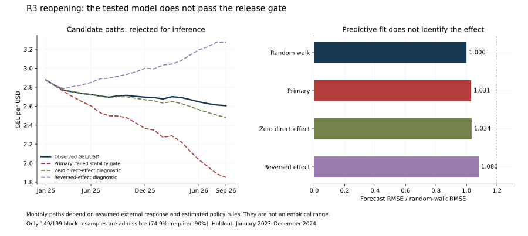

# R3 reopened: a quantitative counterfactual tested and rejected

**Completed 17 November 2026; design registered 16 November.** Evaluation window: January 2025–September 2026, initialized at December 2024. This experiment addresses the fixed study question without changing its episode or starting R7 or a manuscript.

**Decision: withhold a preferred no-purchases GEL/USD path and an empirical range.** A source-calibrated simultaneous-policy model produces a substantial appreciation scenario, but fails its precommitted coefficient-stability/reserve-feasibility requirement. Predictive diagnostics also fail to discriminate between very different assumed intervention effects. This is a completed quantitative modeling experiment, not evidence that purchases had no effect or that every possible conditional model must fail.

The [design amendment](../../research/R3_REOPEN_DESIGN_2026_11_16.md) was committed as [`3546bce`](https://github.com/NikolozOniani/GeorgianNationalBank/commit/3546bce794d093ef6458fa8813d570b14a68e42c) before fitting. Historical outcomes were already known; this was not outcome-blind preregistration. The original [R3 public-evidence decision](../r3_2026_11_12/README.md) remains preserved. G2 remains unsatisfied.

## What the calculation actually produces

The observed September 2026 quote is **2.6051 GEL/USD**. The primary model generates **1.8503 GEL/USD** without purchases. That is a **28.97% lower GEL-per-dollar quote**, or a **40.79% higher dollar value per lari** relative to observed. These are different percentage denominators applied to the same rejected scenario. Neither is an estimate of purchasing-power losses caused by NBG. The unweighted average of the 21 monthly observed/candidate gaps is 14.69%; it is not a welfare average.

| Specification | September candidate GEL/USD | 100 × (observed/candidate − 1), % | Holdout RMSE / random walk | Interpretation |
|---|---:|---:|---:|---|
| Primary: external Table A11, column 4 | 1.8503 | 40.79 | 1.0307 | Failed release gate |
| Column 4, alternative USD 38.1bn GDP scale | 1.9164 | 35.93 | 1.0307 | Scale sensitivity, not an accepted alternative |
| External column 1 | 1.9081 | 36.53 | 1.0283 | Calibration sensitivity |
| External column 7 | 1.8494 | 40.86 | 1.0295 | Calibration sensitivity |
| External column 10 | 1.8077 | 44.11 | 1.0329 | Calibration sensitivity |
| Zero direct intervention kernel | 2.4807 | 5.01 | 1.0338 | Diagnostic; indirect rate response remains |
| Reversed direct intervention kernel | 3.2710 | −20.36 | 1.0804 | Diagnostic falsification case; no external calibration support |

Source: [model comparison](model_comparison.csv), calculated from the registered model and [monthly inputs](model_panel.csv). All 147 candidate-month rows in [candidate paths](candidate_paths.csv) carry `NOT_AN_ACCEPTED_COUNTERFACTUAL`. The spread across rows is **not** an identified interval, a confidence interval, or a probability distribution. The opposite-sign diagnostic is not evidence that purchases strengthened GEL: it demonstrates the insufficiency of forecasting performance to choose a causal sign. The zero-direct-effect case is not a zero-total-effect model because the interest rule responds to intervention.

## Design, estimation and economic closure

The experiment uses 81 monthly observations, January 2020–September 2026. The equations are fitted only on **57 pre-episode months, April 2020–December 2024**, allowing three intervention lags. An expanding-window exercise produces **24 one-month conditional hindcasts for January 2023–December 2024**. Each hindcast predicts interest and intervention jointly, using that month's observed global conditions. Revised annual GDP and realized global conditions make this an ex-post conditional diagnostic, not a real-time forecast. No episode outcome enters coefficient fitting.

The model has three equations: an externally calibrated dynamic exchange-rate equation; an estimated lagged interest-rate rule; and an intervention rule responding to the contemporaneous exchange-rate change. The intervention response uses an assumed orthogonality between FX-market and intervention innovations. It is not an independently verified instrument. The interest innovation is assumed contemporaneously predetermined relative to the FX-market innovation. The [registered equations](../../research/R3_REOPEN_DESIGN_2026_11_16.md) specify every regressor and restriction; [coefficients](coefficients.csv) expose the fitted quantities.

For each episode month, the model recovers innovations from actual outcomes, then applies those same innovations and global conditions to the no-purchases economy. Endogenous histories, interest rates and sales are recomputed. If the simultaneous solution calls for purchases, the purchase constraint binds at zero; otherwise the endogenous sales solution is retained. The model does not mechanically retain observed emergency sales or observed interest rates.

Treatment is conditional on a **minimum-gross, one-way-month convention**: positive observed net intervention is treated as purchases and negative net intervention as sales. This uses the existing USD 5,803.15m net purchase ledger; it does not establish that unobserved two-way BMatch transactions were absent. January 2025 has no recorded net purchases and the candidate initially equals observed. This is an assumption about missing gross treatment, not a repair of G1.

Private portfolio/flow adjustment is compressed into the price equation and its innovations. Actual private flows are not inserted as fixed counterfactual controls. Nevertheless, the model omits explicit trade, output and inflation equations, forward-looking expectations and reserve-confidence feedback. It assumes an unexpected suspension at the start, adaptive propagation, and elastic liquidity management at the endogenous policy rate. Consequently it is a restricted conditional policy model, not a general-equilibrium replication of the Georgian QIPF application.

## Validation results and rejection

| Check fixed before fitting | Result | Decision |
|---|---|---|
| Units, signs, lags, simultaneous clearing, purchase constraint and reserve arithmetic | Focused tests pass; all nominal FXI lag coefficients inverted from the source appreciation convention | Numerical pass |
| Unrestricted reconstruction with recovered innovations | Maximum error below 10⁻⁹ in model-state units | Arithmetic pass only; reconstruction is not predictive validation |
| Primary holdout RMSE ≤ 1.20 × random walk | 1.83635 versus 1.78167 log-percentage points; ratio 1.03069 | Passes declared tolerance, but is 3.07% worse than random walk |
| Primary free-regime transition root < 1 | Maximum modulus 0.98283 | Point-fit stability pass |
| Nonnegative conditional non-gold/non-SDR reserves | Minimum USD 639.80m | Limited accounting pass; not proof of usable reserves |
| At least 90% admissible moving-block resamples | **149/199 = 74.87%** | **Fails release gate** |

The 199 six-month block resamples retain fitted equation rows and original lag relationships, refit Georgian coefficients, and hold external coefficients fixed. **42** have unstable unconstrained state transitions; **8** additional draws violate reserve feasibility; **0** encounter fitting errors. Every draw is retained in [bootstrap.csv](bootstrap.csv). An unstable free-regime root does not imply that a finite constrained path necessarily explodes; the declared stability rule is deliberately conservative. The 90% threshold is a practical acceptance rule, not a statistical significance level or a probability that the model is true. Lowering it after seeing 74.87% would change the design to accommodate the result.

The selected admissible-draw percentiles remain in [validation.json](validation.json) for audit. They exclude the failed draws and hold external calibration fixed, so they must not be marketed as a confidence interval or a bound on the true policy effect. Changing to another calibration or dropping unstable draws does not rescue a preferred estimate under this design.

The baseline fit reproduces actual outcomes because innovations are recovered from those outcomes. This tautology is separate from the held-out predictions. Similar prediction errors under the primary, zero-direct-effect and reversed-effect cases reveal that the chosen forecasting check has little discriminatory power over the relevant policy mechanism. It does not establish that the cases are equally economically plausible.

## Economic checks beyond software correctness

- **External transportability is unverified.** The chosen nominal coefficients come from an international panel, not a modern Georgian purchase episode. The source FXI proxy and trend-GDP normalization differ from our market transactions and actual annual GDP. This experiment does not replicate the source estimation or turn its identification assumptions into Georgian evidence.
- **Policy feedback is fragile.** The estimated interest rule's own lag coefficient is 1.00331. Joint point dynamics are stable, but resampling exposes instability. The rejected candidate raises the September rate from observed 8.25% to 10.289%, despite a much stronger GEL. This is driven by the fitted joint feedback, including the lagged intervention term; it is not a validated inflation-targeting response. The equation omits inflation, output and expectations. Staying within the historical 8–11% range does not make that response economically credible.
- **The scale sensitivity matters.** The primary evaluation scale is the frozen observed 2024 GDP, USD 34.189bn. Replacing it with the previously recorded rounded 2025 USD 38.1bn changes the terminal diagnostic gap from 40.79% to 35.93%. Neither denominator forecasts counterfactual GDP. No annual denominator is divided by twelve.
- **Sales respond, rather than disappear by assumption.** In the primary candidate, March 2026 sales become USD 60.40m versus observed USD 16.2m. The other candidate months have zero intervention. The reserve bridge therefore removes purchases and recomputes sales.
- **Reserve feasibility is incomplete.** The primary endpoint gross stock is USD 2,164.17m, including a USD 639.80m non-gold/non-SDR residual. The bridge holds other reserve movements and actual gold/SDR constant, uses SOFR as a USD return proxy, and excludes undisclosed encumbrances and confidence responses. It is not an estimate of freely usable reserves. Reserve-stock changes are never substituted for intervention transactions.
- **Cash is not welfare.** The primary accumulated difference in FX financing cash is −GEL 15,671.01m. It records changed FX transactions converted at modeled rates, using month-end quotes rather than unavailable execution prices. It is neither measured sterilization expense, exact settlement cash, nor a national economic loss. It is not fed into R4–R6 as an accepted result.
- **Full protocol checks remain open.** This experiment supplies a holdout and accounting tests, but not validated anticipation/news controls, placebo identification, contemporaneous market-depth restrictions or a regime-break identification design. Numerical gates alone could never certify all of G2. NEER and downstream welfare estimation have not been attempted.

## Primary-source provenance and model choice

| Evidence | Exact location and use | Access/interpretation limit |
|---|---|---|
| Adler, Lisack and Mano (2015), *Unveiling the Effects of Foreign Exchange Intervention: A Panel Approach*, IMF WP/15/130 | [Official PDF](https://www.imf.org/-/media/websites/imf/imported-full-text-pdf/external/pubs/ft/wp/2015/_wp15130.pdf), Table A11, physical PDF p.41, nominal columns 1/4/7/10; definitions in Table A1 | Download hash verified. Supplies external magnitude and persistence, not Georgian coefficients. Source uses appreciation-positive rates, an NFA-change proxy, and annual HP-trend USD GDP |
| World Bank, NY.GDP.MKTP.CD, Georgia | [API query](https://api.worldbank.org/v2/country/GEO/indicator/NY.GDP.MKTP.CD?format=json&date=2020:2024&per_page=100); [five extracted annual observations](../../data/derived/r3_reopen_2026_11_16/gdp_observations.csv) | November 2026 retrieval vintage; current-price USD, not contemporaneous historical information vintages |
| Existing NBG and external observations | [Acquisition report](../acquisition_2026_11_09/README.md), [monthly panel](../acquisition_2026_11_09/monthly_policy_panel.csv), [original manifest](../../data/source_manifest.json); R2 [liquidity schedule](../r2_2026_11_11/liquidity_schedule.csv) | Existing pinned inputs reused. Daily broad-dollar/VIX/SOFR observations aggregated only over available dates; monthly counts retained for dollar and VIX |
| Chen et al. (2023), *An Estimated DSGE Model for Integrated Policy Analysis*, IMF WP/23/135 | [Official PDF](https://www.imf.org/-/media/files/publications/wp/2023/english/wpiea2023135-print-pdf.pdf), model and estimation sections | Download hash verified. A broader forward-looking model is available, but the generic model does not supply the complete Georgian implementation or its shock decomposition |
| Georgian QIPF application, NBG *Monetary Economics* 2025/2, and 2025 IMF assessment | Sources reviewed in [earlier R3](../r3_2026_11_12/README.md); two exact NBG retrieval attempts in [new source manifest](../../data/r3_reopen_source_manifest.json) | NBG article text accessible through web retrieval; direct PDF attempts returned 404. The inspected material did not establish a complete Georgian executable calibration. This is an access/replication limit, not proof that no public implementation exists |

The [calibration register](../../research/r3_reopen_calibration.json) records the source column, signs, coefficients and contemporaneous standard errors. The source-verification command checks the actual Table A11 PDF rows against those inputs. Published coefficient rounding and impulse timing conventions prevent claiming exact reconstruction of every published half-life label. The source's joint coefficient covariance is not supplied here; isolated standard errors are not treated as a joint calibration distribution.

A parsimonious, externally anchored policy model was chosen because the existing public evidence does not validate execution-level exogeneity, and an unrestricted short-sample VAR cannot supply it. The broader QIPF route requires a separately documented Georgian calibration, observable-to-model mapping, initial state and shocks. This attempt neither replicates nor rejects the IMF's 2020–2024 welfare result or the Cangul–Abel reserve optimum.

## What is now established, and what must change

There is a reproducible numerical appreciation scenario, but **no accepted answer to “how much stronger or weaker?”** The narrower new result is that this externally anchored model fails a prespecified robustness requirement and that its forecasting performance cannot discriminate between sharply different intervention mechanisms. This rules out presenting its 1.8503 endpoint as the study's estimate; it does not settle the sign of the actual effect.

Any subsequent R3 attempt must change the evidence or the economic model, not the rejection threshold. The immediate modeling requirement is an independently justified Georgian monetary/FX closure: observed inflation and expectations, activity and policy information sets; exchange-market depth or other evidence disciplining the external FX elasticity and persistence; and an explicit expectations/reserve-confidence channel. Public gross-flow detail, if discovered, would narrow treatment ambiguity. A public Georgian QIPF parameter/shock package would support a direct replication attempt; otherwise an independently specified model would need its own pre-fit amendment and validation. These requirements do not authorize contacting NBG or presume that public data alone identify a causal effect.

R7 integration and manuscript drafting remain paused. Rejected paths must not be propagated into household gains, marginal costs, net benefits or an optimal reserve target.

## Reproduction and independent checks

See [R3 reopening replication instructions](../../replication/R3_REOPEN.md). The model outputs are deterministic at the pinned environment. An independent implementation uses pivoted QR instead of the production least-squares solver and a 2×2 matrix solution instead of the production clearing formula. It checks all **147 candidate-month calculations**, with maximum differences below **5 × 10⁻¹⁰ GEL/USD** and **3 × 10⁻⁹ USDm** in reserves; [audit record](independent_checks.json). This verifies the computation, not the economic assumptions. The figure is a diagnostic exhibit, not an uncertainty band.

The [repository verification](repository_validation.json) records **57 current plus 32 archived tests passing**, **120 unchanged archived files**, and numerical agreement for 41 historical outputs (two with the already documented newline-only normalization). Original R0–R6 outputs and archived observations are not regenerated in place. The generic verifier's `new_empirical_estimation: false` describes that verification command, not this research stage: this stage does fit and test the newly registered conditional model.

Rate erratum, 17 November 2026. The original prose understated the observed September 2026 rate by 0.25 percentage point. The model panel and numerical computations already used 8.25%. See the [standalone rate-rule test](../r3_rate_rule/README.md).
