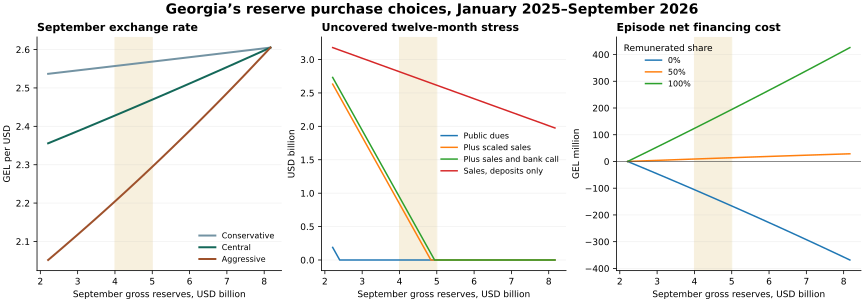

# The marginal reserve-accumulation frontier in Georgia

**Nikoloz Oniani · January 2025–September 2026 · R7 extension, 25 November 2026**

**USD 4.841 billion of gross reserves would have met the September twelve-month public payment schedule plus an import-scaled replay of pandemic FX sales.** Reaching that stock would have taken 44.18% of each month's minimum gross purchases, USD 2.571 billion in total. At USD 5 billion, the central model puts the lari at **2.4694 GEL/USD**, buying **5.49% more dollars per lari** than at the observed rate of 2.6051. The extra accumulation up to the observed USD 8.167 billion added no September protection against that particular stress. It **did** reduce shortfalls against the same stress at eleven earlier month-ends. [September thresholds](coverage_thresholds.csv) · [Earlier month-ends](rolling_protection.csv)

## What different purchase policies would have delivered

Each policy retains the same fraction of every month's minimum gross FX purchases and executes the same sales. The stock labels below refer to September 2026 **gross international reserves**. Narrow liquid FX includes deposits and securities at par, with the same treatment of other positions as R7. The full-purchase row reproduces observed reserves and the exchange rate. Its marginal financing cost and all stress results are modeled. [All 35 policies and three FX calibrations](policies.csv)

| Sept. gross reserves, USDbn | Retained purchases, USDbn | Liquid FX, USDbn | Central GEL/USD | Episode net interest cost, GELm | Twelve-month shortfall with scaled sales, USDm | Shortfall with sales and bank call, USDm |
|---:|---:|---:|---:|---:|---:|---:|
| 2.209 | 0.000 | 0.685 | 2.3558 | 0.00 | 2,631.83 | 2,731.83 |
| 4.000 | 1.749 | 2.476 | 2.4281 | 9.10 | 841.02 | 941.02 |
| 4.500 | 2.238 | 2.976 | 2.4487 | 11.57 | 341.02 | 441.02 |
| 4.841 | 2.571 | 3.317 | 2.4628 | 13.24 | 0.00 | 100.00 |
| 4.941 | 2.668 | 3.417 | 2.4670 | 13.73 | 0.00 | 0.00 |
| 5.000 | 2.726 | 3.476 | 2.4694 | 14.01 | 0.00 | 0.00 |
| 6.000 | 3.703 | 4.476 | 2.5115 | 18.80 | 0.00 | 0.00 |
| 8.167 | 5.819 | 6.643 | 2.6051 | 28.68 | 0.00 | 0.00 |

Financing in the table assumes half the marginal GEL counterpart earns the policy's own interest rate, half earns zero, and incremental USD assets earn SOFR. A lower GEL/USD quote gives a stronger lari. The exact stress thresholds are calculated before rounding. For comparison, **USD 4 billion and USD 5 billion in gross purchases** imply September stocks of USD 6.304 billion and USD 7.328 billion, respectively. [Monthly positions and prices](monthly.csv)



## What the next dollar bought

- **USD 4bn to USD 5bn.** The additional USD 1bn of September assets requires USD 976.77m more purchases over the episode, with reinvested proxy income supplying the balance. Every extra dollar up to USD 4.841bn closes one dollar of the public-plus-scaled-sales gap. The full increment covers USD 841.02m of that stress, or USD 941.02m if a distinct, eligible USD 100m bank claim also falls due. Interest expense rises GEL 65.77m and reserve income rises GEL 60.85m, giving **GEL 4.91m** additional net interest cost. One lari buys 1.67% fewer dollars at the higher stock, relative to the USD 4bn policy. [Incremental accounts](increments.csv)
- **USD 5bn to USD 8.167bn.** USD 3.093bn of additional gross purchases produces USD 3.167bn in additional September assets. September cash headroom rises dollar for dollar at par. None of the additional dollars is needed for the scheduled public payments, scaled sales and separate bank call modeled together. The same holds when testing a 5% securities haircut or a 1%-of-observed-gross operating floor separately. If only deposits can settle the scaled-sales stress, each extra dollar supplies about **20.19 cents** of usable FX. The extra accumulation closes **USD 639.43m** of that gap and still leaves **USD 1.975bn** uncovered. [Stress definitions](../r7_synthesis/METHODS.md) · [Marginal protection](increments.csv)
- **The date matters.** Comparing policies ending at USD 5bn and USD 8.167bn across the 21 episode month-ends, the higher-purchase policy reduces the twelve-month scaled-sales gap at **11**, by as much as **USD 469.56m** from June 2025. Even the full-purchase policy falls short in February, April, May and June 2025 under that replay. On the public schedule alone, the higher policy adds no coverage at any of the 21 origins. The tests overlap and their gaps cannot be summed. [Rolling comparisons](rolling_protection.csv)
- **Financing beyond USD 5bn.** At half remuneration, incremental episode interest expense is **GEL 216.73m**, against **GEL 202.06m** of incremental USD income measured at the corresponding paths' quotes. Net interest cost is **GEL 14.67m**. At zero remuneration the incremental position earns GEL 202.06m net. At full remuneration it costs GEL 231.39m net. The crossover is **46.62%**. Holding September rates and USD balances fixed for a further year gives a separate USD 13.88m incremental net carry cost at half remuneration. The funding mix is unknown. These figures measure the NBG position under the stated assumptions. [Funding and yield sensitivity](policies.csv)
- **Currency exposure.** At USD 5bn the conservative, central and aggressive cases give **2.5685, 2.4694 and 2.2946 GEL/USD**, or 1.42%, 5.49% and 13.53% more USD per lari than observed. The September direction follows the imposed positive purchase effect. The effect vanishes with zero price impact. Changes to intervention timing, reserve confidence or future private flows could change the result. [Monthly paths](monthly.csv) · [R7 sign sensitivity](../r7_synthesis/fx_reversals.csv)

## How much insurance would justify going further?

Public payments alone require USD 2.398bn gross within this family of policies. Keeping pandemic sales at their historical USD amounts raises that to USD 3.378bn. Scaling sales to episode imports raises it to USD 4.841bn. Adding the separate bank claim gives USD 4.941bn. Applying the 5% securities haircut to the scaled-sales test gives USD 4.979bn. Allowing delivery of gold lowers the scaled-sales threshold to USD 3.789bn. Each threshold answers a stated funding question at September's cutoff. None supplies the probability of the stress, the loss if it occurs, or the value of preserving discretion to respond to a larger shock. [All 36 stress and horizon combinations](coverage_thresholds.csv)

**The USD 5bn to USD 8.167bn increment has its own welfare hurdle.** Apply the R7 real-resource test. Suppose an attainable external alternative earns one percentage point more per year, net of risk and the reserve yield. In the common R7 numeraire this increment costs **GEL 342.42m** in December 2024 consumption purchasing power, including acquisition-period exposure and a five-year continuation. If the first crisis would cost USD 3.81bn, and its annual conditional probability at the **USD 5bn policy** were 10%, the extra accumulation would have to reduce that probability to **8.61%** to break even. At a 0.5% or 2% alternative return premium, the required reductions are **0.71 or 2.70 percentage points**. The comparable hurdle for the USD 4bn to USD 5bn increment at a 1% premium is **0.45 points**, if its own starting risk is 10%. The probabilities at the lower stock in each comparison are independent assumptions. Adding their reductions would impose an inconsistent risk schedule. [Marginal insurance hurdles](insurance_hurdles.csv)

The evidence identifies where particular cash uses are fully covered and how much additional insurance would pay for further accumulation. A welfare optimum requires a credible relationship between the reserve stock and crisis frequency or severity, the return on a feasible alternative, and the value of other services. Neither coverage headroom, the GEL interest bill nor a change in the bilateral exchange rate supplies those quantities. An untested severe shock can make the extra stock valuable. A low marginal insurance return can leave it too costly. [R7 resource-cost and benefit distinctions](../r7_synthesis/CLAIMS.md)

## Calculation and replication

1. **Policy definition.** Let $s$ be the share retained, from zero to one. Hold R1's minimum common gross sales (USD 16.20m over the episode), underlying external shocks, non-purchase reserve movements and opening conditions fixed. Reinvest proxy income from the following month. The USD acquisition lot above the zero-purchases path equals $s A_t$, where $A_t$ is R7's full lot including income. September gross reserves are $2{,}209.187+s(5{,}957.733)$ in USDm. The gross stock specifies a monthly proportional policy retrospectively. It is neither a constant reserve floor nor a real-time stopping rule. Alternative timing or unknown paired trades can produce different results for the same ending stock. [R1 minimum legs](../r1_2026_11_10/gross_flow_accounting_bounds.csv) · [R7 monthly accounts](../r7_synthesis/monthly_accounts.csv)
2. **Market and funding paths.** In the three primary R3 calibrations, the direct kernel, monetary feedback and annual-inflation response are linear in the omitted flow. Hence $\log e_t(s)=(1-s)\log e_t(0)+s\log e_t(1)$ and $i_t(s)=(1-s)i_t(0)+s i_t(1)$. Spot GEL/USD levels follow from exponentiation. Price each retained purchase at its own month-end quote. Accrue GEL financing on the opening sum of those GEL principals at the scenario policy rate times the remunerated share. Convert SOFR earnings on opening USD lots at each scenario quote. Subtract earnings from funding expense to obtain net interest cost. The separate displaced-refinancing comparison uses the zero-purchase policy rate to price foregone lending. All costs cover incremental positions only. End-month quotes proxy execution prices. Cross-policy differences also reflect repricing of common retained lots. These nominal interest accounts exclude terminal FX marks. [R3 solution](../r3_policy_feedback/README.md) · [R7 financial accounts including revaluation](../r7_synthesis/funding_accounts.csv)
3. **Liquidity.** For each R7 horizon and stress, gross conditional availability of eligible funds is $U(s)=U(0)+s[U(1)-U(0)]$, using the instrument mix, haircut and outside-payment rules for that stress. The shortfall is $\max(0,D-U(s))$, where $D$ is the peak cumulative call including any operating floor. The marginal service is the difference in shortfalls between policies. At a common origin each extra gross dollar provides $[U(1)-U(0)]/A_t$ of coverage until that gap closes, and zero thereafter. The all-origins column gives the smallest single share clearing every R7 origin, including the common December 2024 opening. Blank means no share in this family suffices. A threshold equal to USD 2.209bn means the no-purchases path already suffices. Thresholds are stock-equivalents within this episode. [R7 paired asset and stress accounts](../r7_synthesis/reserve_stresses.csv)
4. **Resource valuation.** Apply the interval's additional share to R7's existing USD exposure stream. Use the same central no-purchase real exchange rates across all policies so interval costs add in one numeraire. Discount at 3% real, maintain the terminal USD lot for five years, and use R7's zero additional pre-cutoff and terminal insurance-benefit convention. At hazard $p$, the PV of the first loss $L$ is $J(p)=L\sum_{t=1}^5 p(1-p)^{t-1}/1.03^t$. Solve for the risk cut that covers the interval's real resource cost, after translating both sides to December 2024 real GEL. A blank records an unaffordable hurdle even at zero ending risk. The cash stress, financing account and insurance valuation price overlapping channels and must be read separately. [R7 resource valuation](../r7_synthesis/METHODS.md)

Run from the repository root using the [pinned research environment](../../replication/requirements-r3-reopen.txt).

```sh
python src/r7_frontier.py --check
python -m unittest discover -s tests -p test_r7_frontier.py -v
```

Omit `--check` to regenerate the six CSVs and the figure. Adjacent rows of the increments file partition the full stock range. Rows labeled `comparison` span selected wider intervals. The generator checks the SHA-256 digests of the R7 inputs. Tests solve the original R3 equations on partially removed purchase shocks, reprice lots independently, recover both R7 endpoints, verify each sufficiency threshold, and reproduce the first-event break-even calculation. [Generator](../../src/r7_frontier.py) · [Numerical checks](../../tests/test_r7_frontier.py)
