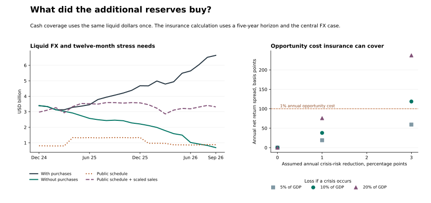

# R7 · Did Georgia gain enough from the reserve purchases?

**Nikoloz Oniani · 25 November 2026 · January 2025–September 2026**

**The purchases moderated appreciation in all three registered calibrations.** The lari actually gained **7.74% against the dollar** over the episode. The central no-purchases path gains **19.15%** from the same opening and ends at **2.3558 GEL/USD** against **2.6051 observed**. At that endpoint one lari buys **10.58% more USD** than it did in the observed economy. Purchases and prices were jointly determined. The positive price-impact calibration supplies the direction of the effect. The Georgian observations establish the trading amounts and the realized exchange rate. [All 21 monthly accounts](monthly_accounts.csv) · [Intervention evidence](../r1_2026_11_10/README.md) · [Exchange-rate and monetary model](../r3_policy_feedback/README.md)

**The extra reserves bought identifiable liquidity under specified stresses. The evidence does not establish that the entire accumulation paid for itself.** At the September cutoff, the no-purchases economy could cover the next three months of scheduled public net FX drains from its narrow liquid portfolio. It would be **USD 188.60m short over twelve months** without other funding. Adding an import-scaled replay of the pandemic sales policy raises the twelve-month gap to **USD 2,631.83m**. The observed portfolio covers both. Whether that service justified the costs depends on the probability and real consequences of running short, on alternative funding and on what productive use the reserves displaced. [Paired stress tests](reserve_stresses.csv) · [Joint results](joint_results.csv)

**A numerical decision rule.** Suppose the marginal dollars could otherwise have earned a net, risk-adjusted external return **1 percentage point a year** above the reserve return. Suppose a first crisis in the five years after September would cost **USD 3.81bn**, with a **10% annual probability** absent the purchases. The central calculation breaks even if reserves cut that probability by **2.55 percentage points each year**, to **7.45%**. A one-point reduction leaves a **GEL 400m shortfall** against the opportunity cost. A three-point reduction gives a **GEL 121m surplus**. Both are discounted to December 2024 consumption purchasing power. Neither the available alternative return nor the achieved risk reduction is observed. The supported verdict is conditional on them. [Resource-cost and insurance thresholds](resource_frontier.csv)

## One episode, two questions

The table holds the funding assumption constant at half policy-rate-equivalent **foregone refinancing** and half zero-interest financing. Read across either reserve-stress column for any FX row. The first two cost columns have different currencies and horizons.

| FX transmission | Sept. GEL/USD without purchases | Extra USD per lari, endpoint / monthly mean | Episode interest cost, nominal GELm | Next-year carry cost at Sept. rates, USDm | Twelve-month liquidity protected, public schedule / schedule plus scaled sales, USDm |
|---|---:|---:|---:|---:|---:|
| Conservative | 2.5367 | 2.69% / 1.41% | 28.68 | 22.28 | 188.60 / 2,631.83 |
| Central | 2.3558 | 10.58% / 4.70% | 21.14 | 14.10 | 188.60 / 2,631.83 |
| Aggressive | 2.0517 | 26.97% / 11.11% | −8.52 | −18.63 | 188.60 / 2,631.83 |

Negative cost means positive net interest income under that funding convention. The stronger monetary easing in the aggressive no-purchases economy reduces the foregone loan yield. The USD balances and conditional protection agree across the rows because the same USD purchases are removed and the same minimum sales retained. Their domestic purchasing value can differ. The full table crosses three FX responses, three policy uses of reserves and three funding shares. A positive FX gain per lari does not count as a national resource loss. [27 joint comparisons](joint_results.csv)

### What would change the currency conclusion?

- **Strength of purchase impact.** Halving or doubling the central impact coefficient alone gives **5.16%** or **22.29%** more USD per lari at the endpoint. Cutting the half-life from ten months to three gives **5.32%**. Diminishing marginal market impact gives **8.29%**. Holding monetary policy fixed gives **10.95%**, compared with **10.58%** after monetary feedback.
- **Sign of the effect.** With zero purchase impact the path returns to **2.6051**. At the central endpoint, an additional **10.06 log points** of depreciation in the no-purchases economy offsets the entire modeled gain. A larger reserve-confidence premium reverses the sign under this additive terminal comparison. Separately, reversing the sign of the direct impulse throughout the linear policy system produces **2.8808**, or **9.57% fewer dollars per lari**. Neither challenger estimates a confidence premium.
- **Gross executions.** NBG disclosed **USD 5,803.15m net**. The minimum gross construction removes **USD 5,819.35m of purchases** and retains **USD 16.20m of sales**. Unreported two-way trading changes the required resources. Adding equal hidden purchases and sales of **USD 31.58m per unknown month** exhausts the September alternative FX account at par. Beyond that point the assumed sale and funding rules require adjustment before extending the path. [Effect and sign sensitivities](fx_reversals.csv) · [Monthly resource thresholds](monthly_accounts.csv) · [Fixed-policy checks of hidden gross legs](../r3_fixed_rate/README.md)

## What did the accumulation cost?

R7 prices successive acquisition lots at the observed official month-end quote, retains their proxy USD earnings, and applies the funding counterfactual to the opening GEL principal each month. By September the lots total **USD 5,957.73m** including **USD 138.38m** of proxy income. They had required **GEL 15,576.58m** of financing principal. The remaining alternative balance is **USD 2,209.19m gross** and **USD 684.78m** in conditional deposit-plus-securities liquidity. Reserve principal remains an asset. These figures assume the purchased dollars earned monthly USD SOFR and the March sale took place in both worlds. [Monthly lot and funding accounts](monthly_accounts.csv)

| Across the 21 months, nominal GELm | Zero remuneration | Half at the observed policy rate | All at the observed policy rate |
|---|---:|---:|---:|
| Reserve interest at accrual-date FX | 368.49 | 368.49 | 368.49 |
| Marginal GEL interest | 0.00 | 397.17 | 794.33 |
| Interest expense less reserve income | −368.49 | 28.68 | 425.85 |
| Cost including September liquidation at 2.6051 | 56.09 | 453.26 | 850.42 |
| Closing GEL/USD for zero marked cost | 2.6145 | 2.6812 | 2.7478 |

The interest-only result changes sign at a **46.39% remunerated share**. The central displaced-refinancing alternative changes sign at **47.29%**. The lari's movement produces a separate **GEL 424.58m** negative mark on the accumulated foreign assets, including retained income. At the observed closing quote the loss on revaluation exceeds proxy interest even with zero remuneration. The 2025 audited whole-portfolio reserve interest was **GEL 401.87m**. Contractual interest on **all** listed CDs was **GEL 11.52m** over the full episode. Treating the full policy-rate column as measured CD expense would exceed the recorded total many times over. The marginal deposit, cash and displaced-refinancing shares remain unidentified. [Funding cases and break-even quotes](funding_accounts.csv) · [Audited costs and consolidation entries](../r4_2026_11_12/README.md)

The table measures the central bank's incremental position under specified funding assumptions. Domestic interest also accrues to its recipients. Internal Treasury–NBG amounts cancel on consolidation. The same foreign asset can acquire a lower GEL book value while retaining its USD capacity to pay a creditor. None of these components alone measures a Georgian household's loss.

## Which reserves actually provide a service?

With purchases, September liquid FX at par was **USD 6,642.51m**. Without them its modeled value was **USD 684.78m**. Starting from the smaller portfolio, the first **USD 100m** and **USD 88.60m of the second tranche** close the public-schedule gap. At half policy-rate financing, carrying each full USD 100m tranche costs USD 0.374m for the year. At a 10% event probability the first tranche must avert 3.74 cents of loss per protected dollar and the second 4.22 cents. The remaining dollars provide no incremental cash coverage of this particular twelve-month schedule. With the scaled sales policy, **26 full tranches and USD 31.83m of the 27th** provide coverage. Market-sales budgets and public payments are assumed disjoint. An unverified bank backstop has no single estimate. A separate USD 100m example requires an additional solvent, collateralized bank call after its own resources and replacement funds are exhausted. [Tranche-by-tranche results](september_tranches.csv)

| Stress from September 2026, USDm | Three-month need | Twelve-month need | Twelve-month gap without purchases | First uncovered group in that scenario |
|---|---:|---:|---:|---|
| Public schedule, no external offset | 233.05 | 873.38 | 188.60 | September 2027 public maturity bucket |
| Public plus pandemic sales at historical dollar amounts | 354.00 | 1,853.85 | 1,169.08 | April 2027 sales |
| Public plus sales scaled to episode imports | 534.44 | 3,316.61 | 2,631.83 | February 2027 sales |
| Scaled sales plus assumed USD 100m eligible bank call | 634.44 | 3,416.61 | 2,731.83 | January 2027 sales |

The public-only twelve-month gap appears at **two** origins, August and September 2026. The scaled-sales replay produces positive incremental twelve-month coverage at **18** of the 21 episode month-ends. These overlapping forecasts are alternative uses of a stock. They cannot be summed into avoided losses. The late-bucket convention supplies the timing shown above. Moving public dues to the beginning of each maturity bucket brings the central first breach forward from February to **January 2027**. None of these dates records an actual default. [All origins and first failures](reserve_stresses.csv)

**Reversals.** September's public-only gap disappears if half of scheduled public drains can be paid externally on time, or if gold can be delivered at its reported value. Under scaled sales, gold access cuts the gap to **USD 1,579.99m**. At a 5% haircut on FX securities it rises to **USD 2,659.16m**. Deposits alone leave even the observed portfolio **USD 1,975.44m short** under that stress. The one- and three-month central replays fit within the no-purchases portfolio, but replacing the three-month sales budget with the historical 2024 peak of **USD 656.6m** produces a **USD 204.87m** shortfall at three months. This alternative uses the historical net total at its own horizon. [Historical comparisons, including 2008 and 2009](historical_comparators.csv)

**How valuable must a dollar of protection be?** At half displaced refinancing, the central forward carrying cost is **USD 14.10m for one year**. If the scaled-sales stress has a 10% chance, each dollar of shortfall closed must avert **5.36 cents** of economic loss or replacement cost to cover that financial hurdle. If only the public schedule matters at that probability, the requirement rises to **74.74 cents**. These are prices the protection would have to command. Cash delivered to meet a claim is principal, not a gain of one dollar of output. [Cost per dollar protected](joint_results.csv)

## Could insurance and financing justify the cost?

**Real-resource test.** Value a feasible alternative use of the dollars by its incremental risk-adjusted external return, after the reserve yield and net of domestic transfers. Its scale is unknown. For each possible return, R7 calculates what reduction in crisis risk would pay for it. At a 10% baseline annual first-crisis risk and a loss equal to 10% of the rounded 2025 GDP benchmark, a reduction from **10% to 9%** can justify at most **0.38% per year** of forgone net return in the central case. A reduction from **10% to 7%** can justify **1.19% per year**. With a 1% alternative return, halving the loss severity raises the required annual risk reduction from **2.55 to 4.86 pp**. Doubling severity cuts it to **1.31 pp**. The exercise charges opportunity cost over the acquisition period and the five-year continuation. It assigns zero additional domestic resource benefit before the cutoff or after liquidation in September 2031. Any such omitted benefit reduces the hurdle dollar for dollar in the same present-value units. [Three FX cases, alternative losses, discount rates and horizons](resource_frontier.csv)

**Financial-hurdle comparison.** A different question is how much insurance would offset the NBG's marked financial cost if a chosen share represented a domestic resource cost. With half the GEL position remunerated, the whole-window financial hurdle through September 2031 is **GEL 639.03m** in December 2024 consumption purchasing power. Taking 100% of this amount as the hurdle requires a reduction of **2.30 pp** in annual first-crisis probability. The prospective carry alone requires **0.86 pp**. Under full policy-rate funding the whole financial hurdle exceeds even eliminating the assumed 10% annual first-crisis risk at this severity. With zero remuneration there is a forward financial gain. The conversion from financial expense to domestic resource cost has no empirical estimate. The external-return test above avoids assigning national losses to GEL interest paid to residents. [Financial break-even sensitivities](insurance_break_even.csv)

**One observed financing exposure.** Immediately before the January 2026 sovereign issue, the December stock gap was **USD 2,467.94m**. Applying zero, half or all of Cangul and Abel's printed log-spread slope to this gap raises modeled proceeds on the issued USD 500m bond by **USD 0, 3.54m or 7.04m**. At full transfer the no-purchases yield is **32.99 bp higher**. Five years of full end-2025 CD-rate-equivalent carrying cost on that opening gap have a **USD 445.38m** issue-date PV. The issue benefit covers the financing hurdle only up to a **48.66%** remunerated share under the full slope, versus **47.84%** with no spread channel. Subsequent purchases cannot alter January's original financing terms. This is a separate financing test and is never added to crisis-loss avoidance. [Issue pricing and funding crossover](bond_channel.csv) · [MoF terms and original-source references](../../research/r6_bond_terms.json)

**Reserve adequacy.** At December 2025 the existing M2 and M3 ARA reconstructions give observed gross coverage of **96.70% and 90.68%**. Removing the modeled lots while freezing each denominator gives **57.95% and 54.35%**. Applying the published **145–150%** target yields gross targets of **USD 9.24–9.55bn (M2)** or **9.85–10.19bn (M3)**. At the observed 75.98% deposit-and-securities share those correspond to **USD 7.02–7.26bn** and **7.48–7.74bn** of narrow liquid FX. September 2026 has no jointly verified ARA denominator here. These static comparisons cannot recover the optimum in the authors' model. The IMF model prices broader crisis, dollarization and market-depth channels. The coverage tests identify a marginal use of the stock that citizens can inspect, conditional on the selected obligation and market policy. [All matched ARA dates and missing cells](ara_comparison.csv) · [Cangul and Abel](https://doi.org/10.5089/9798229051323.018.A001)

## Who could gain or lose?

At the September central rates, a fixed USD 100 import bill costs **GEL 235.58** without purchases against **260.51** observed. An exporter or remittance recipient selling the same USD 100 receives **GEL 24.93 less**. These are bilateral conversion examples. Producer responses and ultimate ownership are unknown. R3 implies **0.1661 pp lower annual inflation** and a reconstructed headline **price level 0.1670% lower** in September. R7 recursively constructs the level from the year-on-year rates. It then applies the same proportional price change to each matched baseline category as a transparent incidence assumption.

| September central exposure, GEL per month at 2024 survey values | Matched basket saving | Loss if all reported transfers retain their USD value | Exposed share of group receipts that reverses the two-channel balance |
|---|---:|---:|---:|
| All households | 1.64 | 5.82 | 28.2% |
| Lowest consumption quintile | 0.62 | 2.24 | 27.6% |
| Highest consumption quintile | 3.09 | 12.75 | 24.2% |
| Households reporting positive foreign transfers | 1.97 | 89.10 | 2.2% |

At zero dollar exposure the positive-recipient group gains the **GEL 1.97** matched saving. With full dollar exposure its two-channel balance becomes **−87.12 GEL**. For all households, assigning each matched retail price a decline equal to one quarter of the quote decline, as in the R5 sensitivity, changes the full-exposure balance from **−4.18 to +17.72 GEL**. This reversal illustrates why assumed retail transmission matters. **24.67%** of national survey consumption is unmatched. The currency and discreteness of receipts, sender adjustments and group-specific pass-through are unknown. Diary-cluster sampling errors for the supported components are separate from model uncertainty. The national totals never include summed group effects. [Group results and sampling errors](household_incidence.csv) · [Corrected survey audit](../r5_2026_11_13/AUDIT.md)

**R7 decision.** The conditional synthesis is complete. The evidence supports a stronger lari without purchases under the registered portfolio responses and a genuine insurance service under specified FX uses. It also supports scenarios in which much of the marginal stock provides no extra coverage of the chosen bills, and scenarios in which the financial or resource ranking reverses. The actual monetary-policy effect, the realized net national cost and the welfare-maximizing reserve level remain unidentified. [Economic assumptions, calculation and reproducibility](METHODS.md) · [Claim ledger and adversarial review](CLAIMS.md)
