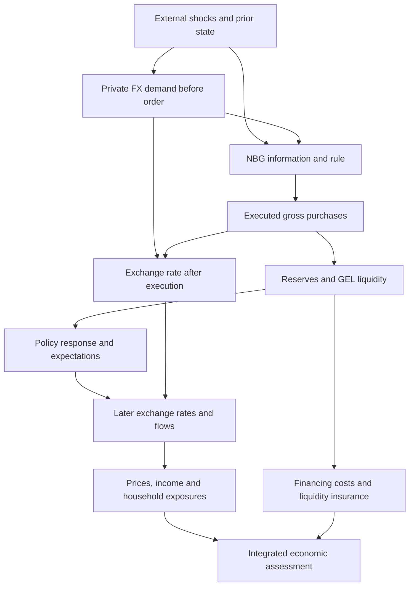

# R0 analysis registration, version 1

**Study:** The Economics of Reserve Accumulation in Georgia: An Independent Assessment of Costs, Benefits, and Optimal Reserve Adequacy

**Author:** Nikoloz Oniani

**Question:** Did the National Bank of Georgia's large-scale foreign-currency purchases prevent the Georgian lari from appreciating, and were the resulting economic costs justified by the benefits of reserve accumulation?

**Scope:** One intervention episode, one economic counterfactual, and its consequences.

Registered 10 November 2026, Asia/Tbilisi, against repository commit `3a16715b6e8c79e4abb2dbb1a596b6e290e3b8e6` and source vintage 9 November 2026. This implements R0 in the [roadmap](ROADMAP.md) under the [protocol](PROTOCOL.md). It is a retrospective analysis registration made after inspection of descriptive outcomes, not an outcome-blind preregistration. No claim of independent replication by another researcher is made.

## 1. Fixed experiment, clocks and windows

| Decision | Registered choice and status |
|---|---|
| Administrative evaluation window | 1 January 2025–30 September 2026; January 2025 is the previously selected study boundary, not a newly verified start of a purchase program |
| Opening positions | 31 December 2024, preserving earlier accumulated assets and contractual obligations in both paths |
| Exact first execution and program start | Unknown. R1 must establish these from transaction/policy evidence; do not assign the first monthly purchase to 1 January or call this the program's inception |
| Cutoff | 30 September 2026 is the final intervention month in the locked vintage. Later FX/reserve observations may supply descriptive follow-up only; they cannot extend treatment coverage without a dated amendment |
| Completed annual accounts | 2025; 2026 is provisional and is not an audited completed year |
| Common measured accounting windows | Monthly net purchases/FX/reserve stocks through September 2026; BOP transaction comparison through Q2 2026; annual audited cost anchor through December 2025. There is no common fully measured causal/welfare panel |
| Pre-period | 2020–2024 wherever comparable. Longer history only for a documented calibration/identification need; it does not create additional episodes for welfare evaluation |
| 2026 continuation | Program termination is unverified. The estimate will concern removal of purchases inside the registered window, not the entire lifetime of an allegedly completed program |
| Later disclosure and revision | No automatic rolling endpoint. A new dated vintage and amendment must state the coverage reason before estimation is rerun; preserve original results and hashes |

Treatment is executed **gross discretionary market purchases** by NBG, classified by currency and instrument. Gross sales are a separate response under the retained emergency-sales rule. Net purchases are an observed accounting aggregate and cannot substitute for treatment. Government conversions, reserve portfolio reallocations, options, forwards and swaps require their own classifications; absence of detail is not zero activity. Preserve March 2026 net sales and all other valid months.

The counterfactual sets discretionary market purchases to zero inside the evaluation window. Initial assets, liabilities and exogenous shocks are identical. Nonpurchase policy rules, institutional constraints and exogenous fiscal financing are retained; their endogenous outcomes, private flows, expectations, rates and liquidity are recomputed. Intervention expectations change consistently with the experiment. A surprise suspension and an anticipated rule change are different information assumptions: R1 must identify the policy information structure, and R3 must register its closure before fitting a model. Neither will be selected because it yields larger appreciation.

After the cutoff, both paths use the same policy rules and exogenous shock distribution, with different inherited states. Purchases outside the window are not automatically suppressed forever. A model must explain how the observed purchase rule resumes and how the state differences decay. This is a continuation of one experiment, not a second policy proposal.

## 2. Estimands, horizons and accounting boundaries

1. Primary FX estimand: the path and terminal gap `100 × (E_actual / E_no_purchase − 1)`, where E is GEL/USD. Positive means GEL was weaker under actual purchases. The quote decline `100 × (1 − E_no_purchase / E_actual)` has a different denominator and must be labeled separately. Report the monthly path and unweighted average of monthly gaps alongside the endpoint; intraday responses are ancillary and cannot simply be summed.
2. Reserve estimand: the difference in usable and gross reserve paths, with currency composition, valuation, income and obligations carried through both paths. Additional purchases do not mechanically equal additional terminal reserves.
3. Financial estimand: accrued incremental reserve return less incremental financing, fees and displaced asset income, first in original currency and then consolidated consistently. Retain NBG and consolidated NBG–government accounts separately.
4. Incidence estimand: household fixed-basket expenditure and separately income/net-exposure changes induced by the same FX path. These are channel-specific effects until preferences, substitution and joint exposures justify a welfare metric.
5. National estimand: expected discounted domestic resource/consumption-equivalent change, only when G1–G5 permit it. Identify domestic transfers, foreign flows and public/private ownership. Do not add basket gains to a representative-agent welfare measure already containing consumption gains.

The realized window ends at the registered cutoff. The primary prospective evaluation includes a five-year continuation to 30 September 2031 with a terminal asset/liability valuation and explicit remaining insurance service; one-, three- and ten-year continuations are sensitivity conventions, not observed forecasts. A finite horizon cannot justify discarding assets or counting their full acquisition value as a loss. If a defensible terminal value cannot be constructed, report finite-window components and an unresolved continuation term; no complete welfare ranking.

Primary national price base/numeraire: December 2024 domestic consumption purchasing power, reported in real GEL. Use a validated national consumption price index only as the common accounting deflator; household price indexes remain group-specific outcomes. Also report original-currency financial accounts and USD exposure schedules without adding them directly to real-GEL welfare. Convert foreign flows using each path's internally consistent exchange rate, not a single convenient end-year rate.

Primary annual real discount rate: 3%, with 0% and 5% sensitivity. These are openly chosen evaluation conventions, not estimates of Georgia's social discount rate or risk premium. Risk is modeled in state-contingent cash flows; do not add the same risk twice in probabilities and discounting. Monthly discounting uses `(1+d)^(-m/12)`. Translate any annual crisis probability to a longer horizon only under an explicit survival/dependence model; multiplication by the number of years is not generally valid.

## 3. Information structure and economic channels

The following time ordering is a design restriction, not an empirically verified causal diagram. Unobserved NBG information must remain a confounder unless an accepted design addresses it. Prices and flows used by the rule must precede order placement.

| Variable | Default role | Rule before empirical use |
|---|---|---|
| Global rates/risk/foreign prices and dated external news | Candidate common shocks | Verify release time and direct Georgian channels; not excluded instruments merely because external |
| Pre-order quotes, prior flows, rule thresholds and NBG information | Assignment/selection inputs | Retain the information set actually available before execution; revised monthly aggregates cannot replace it |
| Government FX conversions/disbursements | Confounder or exogenous fiscal flow, depending on documented origin | Separate fiscal timing from any policy-induced response and from market purchases |
| Realized private inflows, trade, transfers, rates, prices and liquidity | Potential mediators and outcomes | Do not hold their realized values fixed or condition them away without an explicit controlled-effect estimand |
| Disclosure date | Information event | Distinct from order/trade/settlement; disclosure may affect expectations without dating the executed treatment |
| Official FX fixing valid date | Measurement date | Preserve fixing window and effective date; not an execution quote |

## 4. Samples, exclusions, methods and uncertainty

No interpolation of treatment, government flows or valuation; no forward filling missing observations into independent trades; no quarterly-to-monthly disaggregation without a separately labeled model. Do not drop valid crisis periods, sales months or outcomes adverse to the thesis. Keep source rows and excluded values. Duplicate keys, incompatible units or unresolved source anomalies are quarantined from the affected estimand only, not removed from provenance.

Registered exclusions/qualifications: the February 2026 bank-FX aggregate and 30 July 2026 securities total are unusable as validated totals; their components remain separately labeled. The absent 11 October 2025 daily NEER observation stays missing. Preserve historical auction month-boundary and 2023 annual reconciliation discrepancies. Use the complete by-country transfer totals while retaining the alternative workbook differences. Source-specific definitions, microbank coverage and accrued-interest changes require concordance before pooling. The [coverage and access records](../reports/r0_2026_11_10/README.md) describe the locked inputs.

Method sequence is fixed: (a) audit event/IV/threshold identification using execution and rule evidence; (b) if that fails, consider a parsimonious structural model with an independently defended closure; (c) use partial identification only when bounds are justified. Forecasts, synthetic comparisons and contemporaneous regressions are diagnostics, not automatically causal counterfactuals. No valid instrument, assignment threshold, donor group or structural calibration is registered as available now.

Before R3 fitting, commit a design amendment containing the exact estimator, support, parameter provenance/ranges, lag specification, information closure, exclusions and inference method. Numeric bounds for FX elasticity, pass-through, crisis hazard/loss and funding attribution are **unassigned** until source-backed in R2–R6. Logical domains (nonnegative gross flows, positive prices/consumption, probability between zero and one, accessible buffers no larger than admissible holdings) are checks, not informative empirical bounds. Do not impose the sign of the FX effect being tested. A calibration with no Georgian estimate must remain labeled external or assumed.

For an accepted causal design, report two-sided 95% uncertainty intervals and an 80%-power minimum detectable effect at 5% size using its actual assignment, residual dependence and effective sample. There is no numeric MDE in R0 because no accepted design/noise model exists. Assess precision against a predeclared **1 percentage-point endpoint FX-gap benchmark** as a reporting yardstick, not a proven welfare-materiality threshold or exclusion rule. If the design cannot distinguish small effects, say so; do not equate nonsignificance with zero. Correct or jointly report multiplicity for exploratory group outcomes; show all registered primary outcomes.

Historical observations have already been inspected. Any later reserved sample must be declared unused for fitting/tuning; historical holdouts are diagnostic pseudo-out-of-sample checks, not a claim of researcher blindness. Choose temporal blocks within stable regimes, preserve serial dependence, run placebo/anticipation/concurrent-news tests appropriate to the accepted design, and expose weak identification. Survey sampling error, price/pass-through uncertainty, FX identification and model assumptions are reported separately and propagated where possible; a scenario range is not a confidence interval.

## 5. Open decisions assigned to later gates

| Open fact or choice | Required evidence / responsible stage | Claim blocked until resolved |
|---|---|---|
| First trade, gross BMatch flows, purchase-rule version and anticipation | D01–D04 / R1 | Exact treatment and program-start claim; execution causal design |
| Final matched accounting sample and original-currency bridge | D05/D08–D12 / R1/R4 | Matched full-period reserve carry; all-period welfare total |
| IMF component mappings, usable liquidity and model calibration | D13–D15/D18 / R2 | Independently reconstructed current ARA and replicated optimum |
| Valid assignment or structural identification/closure, MDE | D01–D07 / R3 | Numeric prevented-appreciation claim |
| Funding mix, average holdings and return exposures | D09–D12 / R4 | Observed marginal reserve-cost attribution |
| Current household joint exposures, survey design, category coverage and pass-through | D17 / R5 | Precise current household welfare and group ranking |
| Crisis/spread response, terminal continuation/insurance value | D14–D16/D18 / R6 | Complete benefit-cost ranking |

These are explicit estimation gates, not blank spaces to fill with assumptions later without disclosure. R0 registers the decision procedure and current administrative window; it does not certify the missing facts. Change any frozen decision only by a dated amendment recording reason, evidence, prior knowledge and consequences for previously reported estimates. Preserve contrary evidence. The [claim register](../reports/r0_2026_11_10/claim_register.json) binds existing facts and unresolved conclusions to their allowed wording.
